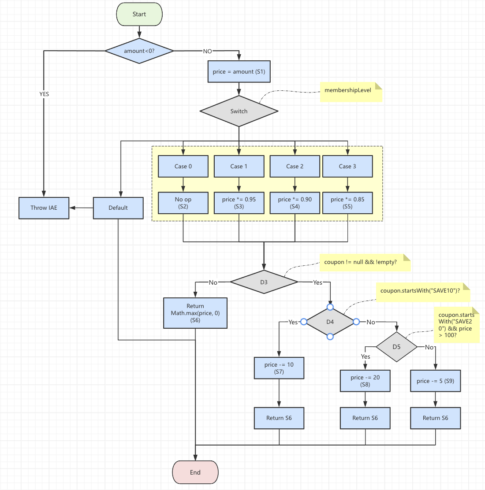

# IN3329 Software Testing Assignment1 Guideline

---
### **Due Date at 24:00 4th May**

### Marking Scheme for Assignment:
1.Code Correctness
2.Coding Style(well-formatted, well commented)
3.Explanation
4.Clearity of test plan.

Please use markdown for writing your report, it will save you tons of time.
**Tutorial:** https://markdown.com.cn/

**DO NOT PLAGRISM!**

You should not copy other's work. You can learn from AI tools, but you SHOULD NOT put AI-generated answers and code in our this mid-term exam.


### 1. Design testing strategies and write unit tests for the following _2_ methods:(5 marks)

The following Code has the same specification:
Input: a String
Output:  The method should return the original string twice, with a “c” appended at the very end
Desicription: "if a = "x", then the method should return "xxc".
```Java
    public static String operationString(String a){
        String b = a;
        b = a+"c";
        // System.out.println(a+b);
        return a+b;
            
    }
    public static StringBuilder operationStringBuilder(StringBuilder a){
        StringBuilder b = a;
        b = a.append("c");
        // System.out.println(a.append(b));
        return a.append(b);
    }
```
Your tasks are:
1. If we want to call these 2 methods for 50000 times, please analyse the difference in performance and explain why there is a gap in performance.
2. Write a collection of test cases for these 2 methods, and explain why you choose these test cases, then use JUnit5 to implement your test.
3. If the method does not match the specification, you should find out why and explain it in *Explaination*
4. Refactor the buggy code.


**Code with testing strategies:**
**1. Testing Strategies**

I want to cover all situations, so I have two methods with the same specification:
Spec: given input a, return a twice plus a "c" at the very end.
Such as: a = "x" → result = "xxc".

*1.1 Equivalence Classes & Boundary*

| Class | Input Condition          | Valid or not | Example Inputs |
|-------|--------------------------|--------------|:---------------|
| 1     | a == null                | Invalid      | null           |
| 2     | a == ""                  | Valid        | ""             |
| 3     | a.length() == 1          | Valid        | "x"            |
| 4     | a.length() > 1           | Valid        | "ab", "@#"     |
| 5     | a contains Emoji/Unicode | Valid        | "你好"         |

*1.2 Representative Test Cases*

| #  | Method                  | Input  | Expected    | Rationale             |
|----|-------------------------|--------|:------------|:----------------------|
| 1  | operationString<br />   | null   | NPE         | invalid null input<br /> |
| 2  | operationString<br />   | ""     | "c"         | boundary empty string |
| 3  | operationString<br />   | "x"    | "xxc"       | single‑char<br />     |
| 4  | operationString<br />   | "ab"   | "ababc"     | multi‑char<br />      |
| 5  | operationString<br />   | "@#"   | "@#@#c"     | special characters<br /> |
| 6  | operationStringBuilder<br /> | null   | NPE         | invalid null input    |
| 7  | operationStringBuilder<br /> | ""     | "c"         | boundary empty        |
| 8  | operationStringBuilder<br /> | "x"    | "xxc"       | single‑char           |
| 9  | operationStringBuilder<br /> | "ab"   | "ababc"     | multi‑char            |
| 10 | operationStringBuilder<br /> | "你好" | "你好你好c" | Unicode handling      |


**2. Write your Java(JUnit) Code here:**

```Java
package com.kamron.software_testing.whiteboxtesting;
import org.junit.jupiter.api.DisplayName;
import org.junit.jupiter.api.Test;
import static org.junit.jupiter.api.Assertions.*;

class OperationStringTest {

    // --------- Tests for operationString(String) ---------

    @Test
    @DisplayName("operationString(null) throws NPE")
    void operationString_null_throwsNPE() {
        assertThrows(NullPointerException.class, () ->
                OperationString.operationString(null));
    }

    @Test
    @DisplayName("operationString(\"\") returns \"c\"")
    void operationString_empty_returnsC() {
        assertEquals("c", OperationString.operationString(""));
    }

    @Test
    @DisplayName("operationString(\"x\") returns \"xxc\"")
    void operationString_singleChar() {
        assertEquals("xxc", OperationString.operationString("x"));
    }

    @Test
    @DisplayName("operationString(\"ab\") returns \"ababc\"")
    void operationString_multiChar() {
        assertEquals("ababc", OperationString.operationString("ab"));
    }

    @Test
    @DisplayName("operationString(\"你好\") returns \"你好你好c\"")
    void operationString_unicode() {
        assertEquals("你好你好c", OperationString.operationString("你好"));
    }

    // --- Tests for operationStringBuilder(StringBuilder) ---

    @Test
    @DisplayName("operationStringBuilder(null) throws NPE")
    void operationStringBuilder_null_throwsNPE() {
        assertThrows(NullPointerException.class, () ->
                OperationString.operationStringBuilder(null));
    }

    @Test
    @DisplayName("operationStringBuilder(\"\") returns \"c\"")
    void operationStringBuilder_empty_returnsC() {
        StringBuilder input = new StringBuilder("");
        StringBuilder result = OperationString.operationStringBuilder(input);
        assertEquals("c", result.toString());
    }

    @Test
    @DisplayName("operationStringBuilder(\"x\") returns \"xxc\"")
    void operationStringBuilder_singleChar() {
        StringBuilder input = new StringBuilder("x");
        StringBuilder result = OperationString.operationStringBuilder(input);
        assertEquals("xxc", result.toString());
    }

    @Test
    @DisplayName("operationStringBuilder(\"ab\") returns \"ababc\"")
    void operationStringBuilder_multiChar() {
        StringBuilder input = new StringBuilder("ab");
        StringBuilder result = OperationString.operationStringBuilder(input);
        assertEquals("ababc", result.toString());
    }

    @Test
    @DisplayName("operationStringBuilder(\"你好\") returns \"你好你好c\"")
    void operationStringBuilder_unicode() {
        StringBuilder input = new StringBuilder("你好");
        StringBuilder result = OperationString.operationStringBuilder(input);
        assertEquals("你好你好c", result.toString());
    }
}
```


**3. Explanation:**
1. Why these tests?
* I cover invalid (null) and boundary ("") inputs, plus single‑char, multi‑char, and Unicode cases, ensuring every equivalence class is exercised.
1. Bug in operationStringBuilder
* Problems:
    1. It mutates the original StringBuilder a twice.
    2. It appends b (which is the same object) to itself ⇒ the result is wrong and grows exponentially if reused.
    3. Does not implement the spec "a" + "a" + "c".
* If I follow the function given in the case [public static String operationString(String a), public static StringBuilder operationStringBuilder(StringBuilder a)], there will be the following output, so I need to refactor the function
  **4. Refactored Code**
```Java
public class OperationString {
    /**
     * Returns the original string twice, with "c" appended at the end.
     * Examples:
     *  - ""   → "c"
     *  - "x"  → "xxc"
     *  - "ab" → "ababc"
     *
     * @param a  the input string (must be non-null)
     * @return   a + a + "c"
     * @throws   NullPointerException if a is null
     */
     
    public static String operationString(String a) {
        if (a == null) {
            throw new NullPointerException("Input string cannot be null");
        }
        return a + a + "c";
    }

    /**
     * Returns a new StringBuilder containing the original content twice
     * followed by 'c'. Does NOT mutate the input builder.
     * Examples:
     *  - ""   → "c"
     *  - "x"  → "xxc"
     *  - "ab" → "ababc"
     *
     * @param a  the input StringBuilder (must be non-null)
     * @return   new StringBuilder(a + a + "c")
     * @throws   NullPointerException if a is null
     */
     
    public static StringBuilder operationStringBuilder(StringBuilder a) {
        if (a == null) {
            throw new NullPointerException("Input StringBuilder cannot be null");
        }
        String s = a.toString();
        return new StringBuilder(s).append(s).append('c');
    }
}
```

**5. Analyse Performance**
Suppose I call each method 50 000 times.

5.1 operationString(String)
* Uses the String + operator twice:
1. a + a → allocates a new String of length 2·n
2. result + "c" → allocates another String of length (2·n+1)
* Time per call: O(n)
* Total: O(N·n) with N=50 000, n=|a|.

5.2 operationStringBuilder(StringBuilder) (refactored)
* Converts a once: a.toString() → O(n)
* Builds new StringBuilder, then three appends (two of length n, one single char) → O(n)
* Time per call: O(n)
* Total: O(N·n).

5.3 Why the gap before refactoring?
* Original operationStringBuilder mutated the same builder across calls. Its length doubled (or more) each call, so next appends cost O(currentLength), leading to exponential growth in total work and memory.
* Result: after a few dozen calls, the builder is huge, each subsequent call slows dramatically and likely triggers OOME.

5.4 Summary
Refactored versions both run in linear time per call with small, bounded temporary allocations. Their performance for 50 000 iterations is comparable and predictable, whereas the original buggy builder version would become catastrophically slow and memory‑hungry.
### 2. Design test strategies for the following code:(5 marks)

If these 2 methods are in the same Calculator software,Your task is to
1. Design Test Strategies.
2. Explain the test result.
3. Discussion, below is the code in main function, please analyse the mistake in this code and try to fix this bug.
   ```Java
     public static void main(String[] args) {
        List<Integer> list = new ArrayList<>();
        list.add(-1);
        list.add(-2);
        list.add(-3);
        int result_Absolute = sumAbsolute(list);
        int result = sum(list);
        System.out.println("the result of absolute value is:\n" +result_Absolute+"\n"+"the result is:\n"+result);

    }
   ```
```Java
public static int sumAbsolute(List<Integer> list) {
        // let's reuse sum(), because DRY, so first we take absolute values
        for (int i = 0; i < list.size(); ++i) {
            list.set(i, Math.abs(list.get(i)));
        }
        return sum(list);
    }
/**
 * @return the sum of the numbers in the list
 */
public static int sum(List<Integer> list) {
    int sum = 0;
    for (int x : list) {
        sum += x;
    }
    return sum;
}

```
2.1 Design Test Strategies
1. Equivalence Classes:
    1. E1: Empty list (list.size() == 0)
    2. E2: All positives (e.g. [1,2,3])
    3. E3: All negatives (e.g. [-1,-2,-3])
    4. E4: Mixed signs (e.g. [-1, 0, 2])
    5. E5: Contains zero
    6. E6: list == null (invalid)
2. Boundary Values
    1. List length: 0, 1, n>1
    2. Element values: 0, Integer.MIN_VALUE, large positives
3. White‑box Focus
    1. Verify that sumAbsolute does not mutate the original list (bug).
    2. Verify that sum returns correct sum over any list.

**Code with testing strategies:**

``` Java
import org.junit.jupiter.api.Test;
import java.util.Arrays;
import java.util.List;
import static org.junit.jupiter.api.Assertions.assertEquals;

public class SumTest {
//The main method will not be detected
    @Test
    public void testSumPositiveNumbers() {
        List<Integer> list = Arrays.asList(1, 2, 3);
        int expected = 6;
        int result = Calculator.sum(list);
        assertEquals(expected, result);
    }

    @Test
    public void testSumNegativeNumbers() {
        List<Integer> list = Arrays.asList(-1, -2, -3);
        int expected = -6;
        int result = Calculator.sum(list);
        assertEquals(expected, result);
    }

    @Test
    public void testSumEmptyList() {
        List<Integer> list = Arrays.asList();
        int expected = 0;
        int result = Calculator.sum(list);
        assertEquals(expected, result);
    }

    @Test
    public void testSumAbsolutePositiveNumbers() {
        List<Integer> list = Arrays.asList(1, 2, 3);
        int expected = 6;
        int result = Calculator.sumAbsolute(list);
        assertEquals(expected, result);
    }

    @Test
    public void testSumAbsoluteNegativeNumbers() {
        List<Integer> list = Arrays.asList(-1, -2, -3);
        int expected = 6;
        int result = Calculator.sumAbsolute(list);
        assertEquals(expected, result);
    }

    @Test
    public void testSumAbsoluteMixedNumbers() {
        List<Integer> list = Arrays.asList(-1, 2, -3);
        int expected = 6;
        int result = Calculator.sumAbsolute(list);
        assertEquals(expected, result);
    }
}
```

**Explanation:**
2.2 For input list •	For input list = [-1,-2,-3]:
1. sumAbsolute as written in‑place converts to [1,2,3] and returns 6.
2. Then calling sum(list) again on the same mutated list returns 6 again.
* But the intended behavior is that sum(list) should still compute the original sum (-6). In main you’d see:= [-1,-2,-3]:

```
the result of absolute value is:
6
the result is:
6
```
which the correct answer is -6

2.3 Bug Fix

Issue: sumAbsolute reuses sum but mutates the input list.
Fix: work on a copy, leave the original list untouched.
```Java
public static int sumAbsolute(List<Integer> list) {
    if (list == null) {
        throw new NullPointerException("List cannot be null");
    }
    // Copy so we don't mutate the original
    List<Integer> copy = new ArrayList<>(list.size());
    for (Integer x : list) {
        copy.add(Math.abs(x));
    }
    return sum(copy);
}

public static int sum(List<Integer> list) {
    if (list == null) {
        throw new NullPointerException("List cannot be null");
    }
    int total = 0;
    for (int x : list) {
        total += x;
    }
    return total;
}
```

### 3. Please write an algorithm to generate Hailstone Sequence:(5 marks)
Given a starting integer n > 0, repeatedly apply:
*   If n == 1, stop.
*   Else if n is even, n = n / 2.
*   Else (odd), n = 3*n + 1.

```
Set an initial n as 3, then your program should calculate the Hailstone Sequence
and print the whole hailstone sequence.
```

the expected input and output should be like this:

input: 3
output: 3,10,5,16,8,4,2,1
```
```
**Code with comment:**

```Java
//This program computes and prints the Hailstone (Collatz) sequence
public class HailstoneMain {
    public static void main(String[] args) {
        //  Set the initial value.
        int n = 3;

        // Generate the sequence as a comma‑separated string.
        String sequence = generateHailstoneSequence(n);

        //  Print the result.
        System.out.println(sequence);
    }
    /**
     * Generates the Hailstone sequence starting at n and returns it
     * as a comma‑separated string, ending with 1
     * @param n the starting integer (must be > 0)
     * @return the sequence, e.g. "3,10,5,16,8,4,2,1"
     * @throws IllegalArgumentException if n <= 0
     */
    public static String generateHailstoneSequence(int n) {
        if (n <= 0) {
            throw new IllegalArgumentException("Starting value must be positive");
        }

        StringBuilder sb = new StringBuilder();

        // Continue until we reach 1.
        while (true) {
            sb.append(n);
            if (n == 1) {
                // Once we've appended 1, the sequence ends.
                break;
            }
            sb.append(',');

            // Compute the next term.
            if (n % 2 == 0) {
                // Even
                n = n / 2;
            } else {
                // Odd
                n = 3 * n + 1;
            }
        }
        return sb.toString();
    }
}
```

### 4.(I) Please Encapsulate the Hailstone calculation process into a method:(5 marks)

```

The Hailstone Method should function like this

Input: an integer n > 0
Return: A corresponding Hailstone Sequence with any length.

```
**Code with comment:**

```Java
package com.kamron.software_testing.whiteboxtesting;

import java.util.List;
import java.util.ArrayList;
import java.util.Scanner;

public class HailstoneSequence {
    public static void main(String[] args) {
    //so that you can input whatever you want
        var scanner = new Scanner(System.in);
        System.out.print("Enter a positive integer n: ");
        int n = scanner.nextInt();
        scanner.close();
        try {
            List<Integer> sequence = hailstoneSequence(n);
            System.out.println(sequence);
        } catch (IllegalArgumentException e) {
            System.err.println("Error: " + e.getMessage());
        }
    }

    /**
     * Computes the Hailstone (Collatz) sequence starting from n.
     * Input:  an integer n > 0
     * Return: a List<Integer> containing the sequence from n down to 1.
     * @param n the starting positive integer (must be > 0)
     * @return the Collatz sequence as a List<Integer>
     * @throws IllegalArgumentException if n <= 0
     */
    public static List<Integer> hailstoneSequence(int n) {
        if (n <= 0) {
            throw new IllegalArgumentException("n must be > 0");
        }

        var seq = new ArrayList<Integer>();
        while (true) {
            seq.add(n);
            if (n == 1) {
                // Terminate when we reach 1
                break;
            }
            // Apply Collatz rule
            n = (n % 2 == 0) ? n / 2 : 3 * n + 1;
        }
        return seq;
    }
}
```

**Explanation:**
1. This program reads a positive integer n from standard input, generates the Hailstone (Collatz) sequence, and prints it, as a comma‑separated list.

2. Example:Input:  17 (or others)
   * Output: 17,52,26,13,40,20,10,5,16,8,4,2,1

3. Rejects non‑positive n, then collects each term in a list. Stops exactly when n == 1, and returns a fresh list, leaving no side‑effects.


### 4.(II) Test the Hailstone Method:(5 marks)

Please Write your test strategies and test this method.
**Testing strategies:**

1. Equivalence: Valid: n ≥ 1, Invalid: n ≤ 0

2. Representative Cases
*   n = 1 → [1] (boundary)
*   n = 2 → [2,1] (small even)
*   n = 3 → [3,10,5,16,8,4,2,1] (small odd)
*   n = 6 → [6,3,10,5,16,8,4,2,1] (longer)
*   n = 0 → exception
*   n = -5 → exception

**JUnit Code**

```Java
package com.kamron.software_testing.whiteboxtesting;

import org.junit.jupiter.api.Test;
import static com.kamron.software_testing.whiteboxtesting.HailstoneSequence.hailstoneSequence;
import static org.junit.jupiter.api.Assertions.*;
import java.util.Arrays;
import java.util.List;

class HailstoneTest {
    @Test
    void testNEqualsOne() {
        assertEquals(Arrays.asList(1), hailstoneSequence(1));
    }

    @Test
    void testNEqualsTwo() {
        assertEquals(Arrays.asList(2,1), hailstoneSequence(2));
    }

    @Test
    void testNEqualsThree() {
        List<Integer> expected = Arrays.asList(3,10,5,16,8,4,2,1);
        assertEquals(expected, hailstoneSequence(3));
    }

    @Test
    void testNEqualsSix() {
        List<Integer> expected = Arrays.asList(6,3,10,5,16,8,4,2,1);
        assertEquals(expected, hailstoneSequence(6));
    }

    @Test
    void testZeroThrows() {
        assertThrows(IllegalArgumentException.class, () -> hailstoneSequence(0));
    }

    @Test
    void testNegativeThrows() {
        assertThrows(IllegalArgumentException.class, () -> hailstoneSequence(-5));
    }
}
```


### 5. Unit Test Questions(30 marks)
Unit Test Questions are in the Unit Test Question.pdf file, please refer to that file and answer the questions here.

### 5.1 Test Strategies
White‑box
1. Cover the single return a + b; statement.
2. Although there are no explicit branches, consider integer overflow wrap‑around behavior.

Black‑box
1. Equivalence partitions:
   (1). Two positives
   (2). Two negatives
   (3). One positive, one negative
   (4). Involving zero
   (5). Boundary values (Integer.MAX_VALUE, Integer.MIN_VALUE and their neighbors)
2. Boundary value analysis:
   (1). MAX_VALUE + 1 → wraps to MIN_VALUE
   (2). MIN_VALUE - 1 → wraps to MAX_VALUE

### 5.1 Test Code
```Java
package com.kamron.software_testing.whiteboxtesting;
import org.junit.jupiter.api.Test;
import static org.junit.jupiter.api.Assertions.*;

class CalculatorTest {
    private final Calculator calc = new Calculator();

    @Test
    void testAddTwoPositives() {
        assertEquals(3, calc.add(1, 2));
    }

    @Test
    void testAddTwoNegatives() {
        assertEquals(-5, calc.add(-2, -3));
    }

    @Test
    void testAddPositiveAndNegative() {
        assertEquals(2, calc.add(5, -3));
    }

    @Test
    void testAddWithZero() {
        assertEquals(5, calc.add(5, 0));
        assertEquals(5, calc.add(0, 5));
    }

    @Test
    void testOverflowMaxPlusOne_wrapsToMin() {
        assertEquals(Integer.MIN_VALUE, calc.add(Integer.MAX_VALUE, 1));
    }

    @Test
    void testUnderflowMinMinusOne_wrapsToMax() {
        assertEquals(Integer.MAX_VALUE, calc.add(Integer.MIN_VALUE, -1));
    }
}
```
### 5.2 Test Strategies
White‑box
1. **Branch 1**: s == null → returns null.
2. **Branch 2**: s != null → enters the for loop.
   • Zero iterations (empty string)
   • One iteration (single‑char)
   • Multiple iterations


Black‑box
*   Equivalence partitions:
1.   null
2.   Empty string ""
3.   Single‑character string
4.   Regular multi‑character string
5.   String containing spaces
6.   String containing special characters (punctuation, non‑ASCII, emoji)
*   Boundary values: strings that begin or end with special characters

**_Explain:_**

When it comes to testReverseSpecialChars() function, it goes wrong because the original `reverse` method reversed the string by char. However, in Java, characters like emojis (such as 😄) are composed of two `char`s instead of one. Therefore, when you use `charAt(i)` to concatenate characters from back to front one by one, it will split this emoji into two incomplete parts.
So a method to reverse should change into:

```Java
public class StringUtil {
    /**
     * correctly handling surrogate pairs (e.g. emojis).
     * Unicode code points in reverse order
     */
    public String reverse(String s) {
        if (s == null) {
            return null;
        }
        // Extract all code points from s into an int[]
        int[] codePoints = s.codePoints().toArray();
        // Build a new String from them in reverse order
        StringBuilder sb = new StringBuilder(codePoints.length);
        for (int i = codePoints.length - 1; i >= 0; i--) {
            sb.appendCodePoint(codePoints[i]);
        }
        return sb.toString();
    }
}
```
### 5.2 Test Code
```Java
package com.kamron.software_testing.whiteboxtesting;

import org.junit.jupiter.api.Test;
import static org.junit.jupiter.api.Assertions.*;

class StringUtilTest {
    private final StringUtil util = new StringUtil();

    @Test
    void testReverseNull() {
        assertNull(util.reverse(null));
    }

    @Test
    void testReverseEmpty() {
        assertEquals("", util.reverse(""));
    }

    @Test
    void testReverseSingleChar() {
        assertEquals("A", util.reverse("A"));
    }

    @Test
    void testReverseNormal() {
        assertEquals("normaK", util.reverse("Kamron"));
    }

    @Test
    void testReverseWithSpaces() {
        assertEquals("c b a", util.reverse("a b c"));
    }

    @Test
    void testReverseSpecialChars() {
        String input = "Hi! 我是Kamron💣";
        String expected = "💣normaK是我 !iH";
        assertEquals(expected, util.reverse(input));
    }
}
```
### 5.3 Test Strategies
White‑box
1. **Branch 1**: either parameter is null → returns false.
2. **Branch 2**: both non‑null → perform "admin".equals(username) && "123456".equals(password).
*  Successful login path
*  Username wrong
*  Password wrong
*  Both wrong

Black‑box
* Equivalence partitions:
1. Correct username/password
2. Username incorrect, password correct
3. Username correct, password incorrect
4. Both incorrect
5. Empty strings
6. null inputs
* Boundary values: username length 0 vs. 5, password length 0 vs. 6
### 5.3 Test Code
```Java
package com.kamron.software_testing.whiteboxtesting;

import org.junit.jupiter.api.Test;
import static org.junit.jupiter.api.Assertions.*;

import org.junit.jupiter.api.Test;
import static org.junit.jupiter.api.Assertions.*;

class AuthServiceTest {
    private final AuthService auth = new AuthService();

    @Test
    void testLoginCorrect() {
        assertTrue(auth.login("admin", "123456"));
    }

    @Test
    void testLoginWrongUsername() {
        assertFalse(auth.login("user", "123456"));
    }

    @Test
    void testLoginWrongPassword() {
        assertFalse(auth.login("admin", "abcdef"));
    }

    @Test
    void testLoginBothWrong() {
        assertFalse(auth.login("user", "pwd"));
    }

    @Test
    void testLoginEmptyStrings() {
        assertFalse(auth.login("", ""));
    }

    @Test
    void testLoginNullUsername() {
        assertFalse(auth.login(null, "123456"));
    }

    @Test
    void testLoginNullPassword() {
        assertFalse(auth.login("admin", null));
    }
}
```
### 5.4 Test Strategies
White‑box
1. **Branch 1**: x < 0, return -x.
2. **Branch 2**: x >= 0, return x.

Black‑box
1. Equivalence partitions: negative, zero, positive, Integer.MIN_VALUE.
2. Boundary values: -1, 0, 1, MIN_VALUE, MAX_VALUE.
### 5.4 Test Code
```Java
package com.kamron.software_testing.whiteboxtesting;
import org.junit.jupiter.api.Test;
import static org.junit.jupiter.api.Assertions.*;

class MathUtilTest {
    private final MathUtil mu = new MathUtil();

    @Test
    void testNegative() {
        assertEquals(10, mu.absolute(-10));
    }

    @Test
    void testZero() {
        assertEquals(0, mu.absolute(0));
    }

    @Test
    void testPositive() {
        assertEquals(25, mu.absolute(25));
    }

    @Test
    void testMaxValue() {
        assertEquals(Integer.MAX_VALUE, mu.absolute(Integer.MAX_VALUE));
    }

    @Test
    void testMinValue_overflow() {
        // MIN_VALUE overflows and remains MIN_VALUE
        assertEquals(Integer.MIN_VALUE, mu.absolute(Integer.MIN_VALUE));
    }
}
```
### 5.5 Test Strategies
White‑box
1. **Branch 1:** score < 0 || score > 100 → throw IllegalArgumentException.
2. **Branches 2–6:**
*   score >= 90 → "A"
*   score >= 80 → "B"
*   score >= 70 → "C"
*   score >= 60 → "D"
*   else → "F"

Black‑box
1. Decision table covering out‑of‑range and each grade band.
2. Boundary values: -1, 0, 59, 60, 69, 70, 79, 80, 89, 90, 100, 101.
### 5.5 Test Code
```Java
import org.junit.jupiter.api.Test;
import static org.junit.jupiter.api.Assertions.*;

class GradingTest {
    private final Grading grading = new Grading();

    @Test
    void testBelowZero_throws() {
        assertThrows(IllegalArgumentException.class, () -> grading.grade(-1));
    }

    @Test
    void testF_boundaryAndBelow() {
        assertEquals("F", grading.grade(0));
        assertEquals("F", grading.grade(59));
    }

    @Test
    void testD_boundary() {
        assertEquals("D", grading.grade(60));
        assertEquals("D", grading.grade(69));
    }

    @Test
    void testC_boundary() {
        assertEquals("C", grading.grade(70));
        assertEquals("C", grading.grade(79));
    }

    @Test
    void testB_boundary() {
        assertEquals("B", grading.grade(80));
        assertEquals("B", grading.grade(89));
    }

    @Test
    void testA_boundaryAndAbove() {
        assertEquals("A", grading.grade(90));
        assertEquals("A", grading.grade(100));
    }

    @Test
    void testAboveHundred_throws() {
        assertThrows(IllegalArgumentException.class, () -> grading.grade(101));
    }
}
```

### 6.Multiply Method Design and Test(10 marks):

Your task here is to
1.design a calculation method which can calculate integers from Long.MIN_VALUE-1 to + Long.MAX_VALUE+1 and

2. design a suitable test strategy and implement it in JUnit.

****

**1.Calculation Method**

``` Java
package com.kamron.software_testing.whiteboxtesting;
import java.math.BigInteger;

public class BigMath {
    /*
     * Returns the exact product of a and b.
     * Supports values outside long range (e.g. Long.MIN_VALUE−1, Long.MAX_VALUE+1).
     */
    public BigInteger multiply(BigInteger a, BigInteger b) {
        return a.multiply(b);
    }
}
```

**2.Test Strategies**
White‑box
* There are no explicit branches beyond delegating to BigInteger.multiply.

Black‑box
* Equivalence partitions:
1. Zero
2. Positive × positive
3. Negative × positive
4. Negative × negative
5. **Boundary values:**
    * Long.MIN_VALUE−1, Long.MIN_VALUE, Long.MIN_VALUE+1
    * −1, 0, 1
    * Long.MAX_VALUE−1, Long.MAX_VALUE, Long.MAX_VALUE+1
* Boundary analysis: multiply each boundary operand by 1, by itself, and by other boundaries.

**3.Junit Code**

```Java
package com.kamron.software_testing.whiteboxtesting;

import org.junit.jupiter.api.Test;
import java.math.BigInteger;
import static org.junit.jupiter.api.Assertions.*;

class BigMathTest {
    private final BigMath bm = new BigMath();

    // Boundary constants
    private static final BigInteger MIN_MINUS_ONE =
            BigInteger.valueOf(Long.MIN_VALUE).subtract(BigInteger.ONE);
    private static final BigInteger MIN =
            BigInteger.valueOf(Long.MIN_VALUE);
    private static final BigInteger MIN_PLUS_ONE =
            BigInteger.valueOf(Long.MIN_VALUE).add(BigInteger.ONE);
    private static final BigInteger MAX_MINUS_ONE =
            BigInteger.valueOf(Long.MAX_VALUE).subtract(BigInteger.ONE);
    private static final BigInteger MAX =
            BigInteger.valueOf(Long.MAX_VALUE);
    private static final BigInteger MAX_PLUS_ONE =
            BigInteger.valueOf(Long.MAX_VALUE).add(BigInteger.ONE);

    @Test
    void testZeroTimesAnything() {
        assertEquals(BigInteger.ZERO, bm.multiply(BigInteger.ZERO, MAX));
        assertEquals(BigInteger.ZERO, bm.multiply(BigInteger.ZERO, MIN));
    }

    @Test
    void testPositiveTimesPositive() {
        assertEquals(BigInteger.valueOf(6),
                bm.multiply(BigInteger.valueOf(2), BigInteger.valueOf(3)));
    }

    @Test
    void testNegativeTimesPositive() {
        assertEquals(BigInteger.valueOf(-6),
                bm.multiply(BigInteger.valueOf(-2), BigInteger.valueOf(3)));
    }

    @Test
    void testNegativeTimesNegative() {
        assertEquals(BigInteger.valueOf(6),
                bm.multiply(BigInteger.valueOf(-2), BigInteger.valueOf(-3)));
    }

    @Test
    void testBoundary_MIN_MINUS_ONE() {
        // (MIN−1) * 1 == MIN−1
        assertEquals(MIN_MINUS_ONE, bm.multiply(MIN_MINUS_ONE, BigInteger.ONE));
    }

    @Test
    void testBoundary_MIN_PLUS_ONE_times_MAX_PLUS_ONE() {
        BigInteger expected = MIN_PLUS_ONE.multiply(MAX_PLUS_ONE);
        assertEquals(expected, bm.multiply(MIN_PLUS_ONE, MAX_PLUS_ONE));
    }

    @Test
    void testBoundary_MAX_times_MAX() {
        BigInteger expected = MAX.multiply(MAX);
        assertEquals(expected, bm.multiply(MAX, MAX));
    }
}
```
### 7.Order Calculator Test(35 marks)
Please read carefully and answer in three clearly‑labeled sections: **Black‑Box Testing**, **White‑Box Testing**, and **JUnit Test Code**.

---

```java


public class OrderCalculator {
    /**
     * Calculate the final payment price.
     * 
     * @param amount          Original order amount, must be ≥ 0
     * @param membershipLevel 0 = regular, 1 = silver, 2 = gold, 3 = diamond;
     *                        any other value → IllegalArgumentException
     * @param coupon          Coupon code, may be null or empty
     * @return                Discounted price, never below 0
     */
    public static double calculateFinalPrice(
            double amount, int membershipLevel, String coupon) {
        if (amount < 0) {
            throw new IllegalArgumentException("Invalid amount");
        }
        double price = amount;
        switch (membershipLevel) {
            case 1: price *= 0.95; break;
            case 2: price *= 0.90; break;
            case 3: price *= 0.85; break;
            case 0: /* no discount */ break;
            default:
                throw new IllegalArgumentException("Invalid membershipLevel");
        }
        // Coupon logic
        if (coupon != null && !coupon.isEmpty()) {
            if (coupon.startsWith("SAVE10")) {
                price -= 10;
            } else if (coupon.startsWith("SAVE20") && price > 100) {
                price -= 20;
            } else {
                price -= 5;
            }
        }
        return Math.max(price, 0);
    }
}
```

---

### I. Black‑Box Testing (10 points)

1. **Equivalence Class Partitioning** (3 points)
    - Partition the input domain along the three parameters (`amount`, `membershipLevel`, `coupon`), list each equivalence class and mark it “valid” or “invalid.”

| Parameter        | Equivalence Class       | Valid/Invalid |
|------------------|-------------------------|---------------|
| amount           | amount < 0              | Invalid       |
|                  | amount = 0              | Valid         |
|                  | amount > 0              | Valid         |
| membershipLevel<br /> | level ∈ {0,1,2,3}<br /> | Valid         |
|                  |  level ∉ {0,1,2,3}<br /> | Invalid       |
| coupon<br />     | null                    | Valid         |
|                  | "" (empty)              | Valid         |
|                  | starting with "SAVE10"<br /> | Valid         |
|                  | starting with "SAVE20"  | Valid         |
|                  | other (e.g. "XYZ")<br /> | Valid         |


2. **Representative Value Selection** (2 points)
    - For each equivalence class identified above, give one representative test value (or combination).

| Representative (amount, level, coupon) | Expectation                                |
|----------------------------------------|--------------------------------------------|
| (-5, 5, null)                          | throws IllegalArgumentException for amount |
| (0, 0, null)                           | 0.0                                        |
| (50, 1, "")                            | 50 * 0.95 = 47.5                           |
| (50, 4, null)                          | throws IllegalArgumentException for level  |
| (100, 1, "SAVE10OFF"）                  | (100*0.95) - 10 = 85                       |
| （80, 0, "XYZ")                         | 80 - 5 = 75                                |


3. **Boundary Value Analysis** (3 points)
    - Identify the boundary (and just‑outside) values for each input dimension, then propose a **minimal** set of test cases (at least 6–8).

**Boundaries**:
* amount: a number just below 0, 0, small positive(0.01), large(200)
* membershipLevel: -1, 0, 1, 2, 3, 4
* coupon: null, "", "SAVE10", "SAVE20", "OTHER"


| amount | level | coupon  | why                                                   |
|--------|-------|---------|:------------------------------------------------------|
| -1     | 0     | null    | amount < 0 so exception                               |
| 0      | 0     | null    | zero amount, no discount                              |
| 50     | 1     | null    | silver discount only<br />                            |
| 150    | 2     | SAVE10X | gold + SAVE10<br />                                   |
| 120    | 3     | SAVE20X | diamond + SAVE20 (price>100)                          |
| 80     | 3     | SAVE20X | diamond + SAVE20 (price≤100) uses fallback            |
| 40     | 0     | ABC     | regular + other coupon (–5)                           |
| 5      | 3     | SAVE10  | discount + coupon driving price below 0, floored to 0 |


4. **Parameterized Test Design** (2 points)
    - Briefly describe how you would organize these test cases using JUnit 5’s `@ParameterizedTest` (for example, using `@CsvSource`).

```Java
@ParameterizedTest
@CsvSource({
  // amount, level, coupon, expectedResult, expectException?
  "-1, 0,    ,      , true",    // exception
  "0,  0,    ,      0.0, false",
  "50, 1,    ,     47.5, false",
  "150,2, SAVE10, 125.0, false",
  "120,3, SAVE20,  82.0, false",
  "80, 3, SAVE20,  75.0, false",
  "40, 0, ABC,    35.0, false",
  "5,  3, SAVE10, 0.0,  false"
})
void parameterizedFinalPrice(double amount,
                             int level,
                             String coupon,
                             Double expected,
                             boolean expectException) {
    if (expectException) {
        assertThrows(IllegalArgumentException.class,
            () -> OrderCalculator.calculateFinalPrice(amount, level, coupon));
    } else {
        double actual = OrderCalculator.calculateFinalPrice(amount, level, coupon);
        assertEquals(expected, actual, 1e-6);
    }
}
```
---

### II. White‑Box Testing (10 points)

1. **Control‑Flow Graph (CFG)** (3 points)
    - Draw the method’s control‑flow graph, labeling all decision nodes and outgoing branches.
      

**Nodes:**
*   Entry
*   D1: amount<0?
*   D2: switch on membershipLevel (cases 1,2,3,0,default)
*   D3: coupon!=null && !coupon.isEmpty()?
*   D4: coupon.startsWith("SAVE10")?
*   D5: coupon.startsWith("SAVE20") && price>100?
*   S1: initialize price
*   S2–S5: diferent discount statements
*   S6: Return Math.max(price, 0)
*   S7–S9: The amount of the coupon is reduced

2. **Statement & Branch Coverage** (3 points)
    - Based on your CFG, specify the **smallest** set of test cases that achieves 100% statement coverage and 100% branch coverage. Explain why your set covers every statement and branch.

| Case | Params               | Covers                                       |
|------|----------------------|----------------------------------------------|
| W1   | (–1, 0, null)<br />  | D1 true → throw amount < 0                   |
| W2   | (50, 0, null)<br />  | D1 false; skip switch discount; D3 false     |
| W3   | (100, 1, "SAVE10X")<br /> | switch→case1; D3 true; D4 true               |
| W4   | (120, 3, "SAVE20X")<br /> | switch→case3; D3 true; D4 false; D5 true     |
| W5   | (80, 3, "XYZ")<br /> | switch→case3; D3 true; D4 false; D5 false    |
| W6   | (5, 3, "SAVE10")<br /> | drives price - 10 < 0 → floor to 0 at return |

Why?:
* 1. Statements: throw, initialization, each price *=, each coupon branch, final Math.max
* 2. Branches: both outcomes of D1, all switch branches (including default via W1 for default-level exception), both outcomes of D3, both for D4, both for D5, both for Math.max when price<0 and ≥0.

3. **Path Coverage** (3 points)
    - Enumerate **all feasible execution paths** through the method (you should list at least 8 distinct paths). Then choose any **three** of these paths and give concrete parameter values for each.
        1. D1=true → throw
        2. D1=false → level=0 → D3=false → return
        3. D1=false → level=1 → D3=false → return
        4. D1=false → level=1 → D3=true → D4=true → return
        5. D1=false → level=2 → D3=true → D4=false → D5=false → return
        6. D1=false → level=2 → D3=true → D4=false → D5=true → return
        7. D1=false → level=3 → D3=true → D4=true → return
        8. D1=false → level=3 → D3=true → D4=false → D5=true → return
        9. D1=false → default level (e.g. 5) → throw

Three Concrete Examples:
*   Path 2: (0.0, 0, null) → no membership discount, no coupon.
*   Path 4: (100.0, 1, "SAVE10X") → silver + SAVE10 branch.
*   Path 6: (120.0, 2, "SAVE20CODE") → gold + SAVE20 when price>100.


4. **Maintainability & Refactoring** (1 points)
    - Identify at least one readability or extensibility issue in the method, and propose a refactoring or design improvement (e.g. extract submethod, simplify nested conditions).

    1. Issue: deep nesting of coupon logic inside main method hurts readability and makes it hard to extend (e.g. new coupon types comes).
    2. Refactoring: extract a private class `private static double applyCoupon(double price, String coupon) { }` and call it after the switch. This isolates coupon rules and simplifies calculateFinalPrice.

### III. JUnit Code(15 marks)
---
```Java
package com.kamron.software_testing.whiteboxtesting;

import org.junit.jupiter.api.Test;
import org.junit.jupiter.params.ParameterizedTest;
import org.junit.jupiter.params.provider.CsvSource;

import static org.junit.jupiter.api.Assertions.*;

class OrderCalculatorTest {

    @Test
    void testNegativeAmountThrows() {
        assertThrows(IllegalArgumentException.class,
                () -> OrderCalculator.calculateFinalPrice(-1.0, 0, null));
    }

    @Test
    void testInvalidLevelThrows() {
        assertThrows(IllegalArgumentException.class,
                () -> OrderCalculator.calculateFinalPrice(50.0, 5, ""));
    }

    @ParameterizedTest
    @CsvSource({
            // amount, level, coupon, expected, expectException
            "0.0, 0,    ,      0.0,  false",
            "50.0, 0,    ,     50.0,  false",
            "50.0, 1,    ,     47.5,  false",
            "100.0,1, SAVE10,  85.0,  false",
            "120.0,2, SAVE20,  88.0,  false",  // 120*0.90=108→108-20=88
            "80.0, 3, SAVE20,  63.0,  false",  // 80*0.85=68→<100 so -5, 68-5=63
            "40.0, 0, ABC,    35.0,  false",  // -5 fallback
            "5.0,  3, SAVE10,  0.0,  false"   // 5*0.85=4.25→4.25-10<0→0
    })
    void parameterizedCalculate(double amount,
                                int level,
                                String coupon,
                                double expected,
                                boolean expectException) {
        if (expectException) {
            assertThrows(IllegalArgumentException.class,
                    () -> OrderCalculator.calculateFinalPrice(amount, level, coupon));
        } else {
            double actual = OrderCalculator.calculateFinalPrice(amount, level, coupon);
            assertEquals(expected, actual, 1e-6);
        }
    }
}
```
