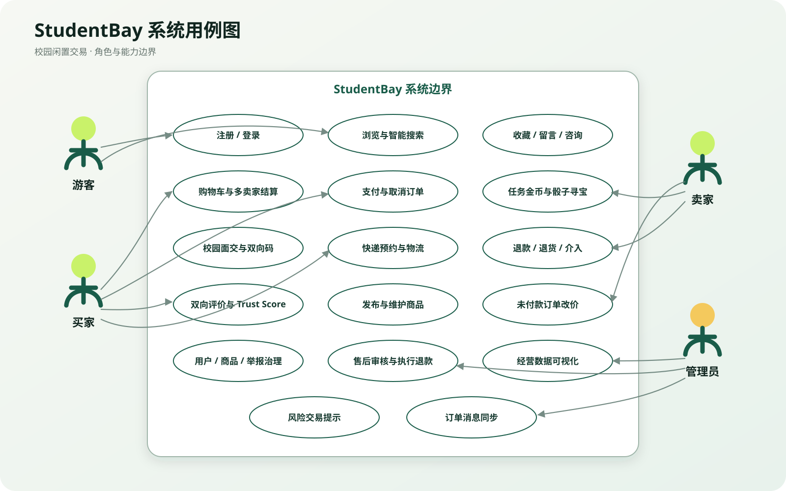
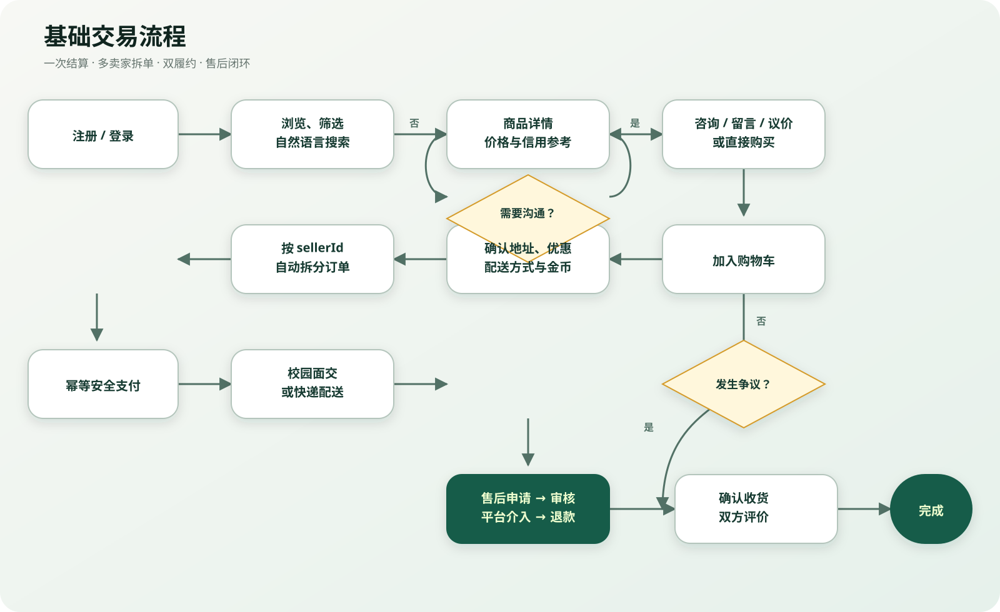
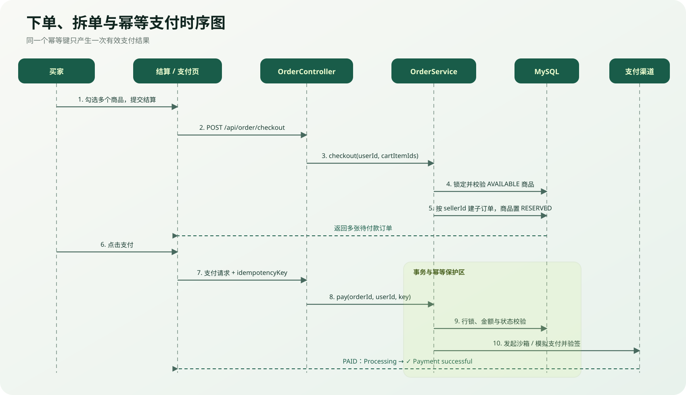
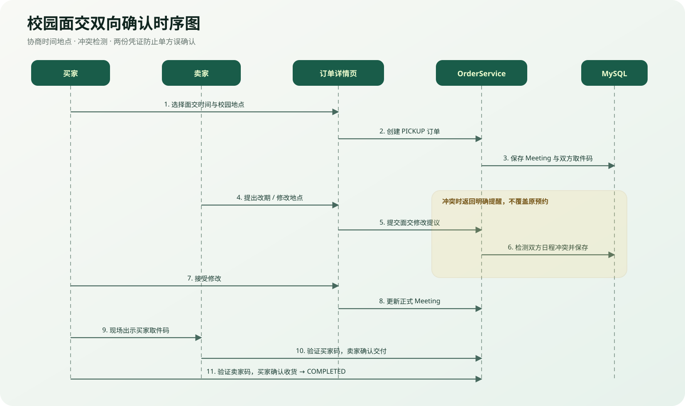
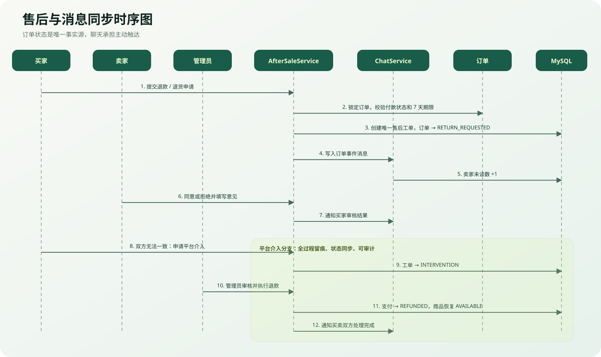

# StudentBay 产品说明书

> 版本：Day10 / v1.0  
> 日期：2026-09-09  
> 产品定位：面向高校内部可信交易场景的校园闲置物品交易平台

## 1. 产品简介

StudentBay 为高校学生提供商品发布、智能发现、咨询议价、购物车结算、校园面交或快递履约、评价信用、退款售后与平台治理的一体化服务。

产品并非只展示二手信息，而是围绕真实交易中的库存、钱款、交付凭证、时间冲突、信任和争议处理建立完整闭环。

## 2. 产品价值与特色

| 用户问题 | StudentBay 方案 | 产品价值 |
|---|---|---|
| 搜索词不准确 | 自然语言搜索解析预算、品类、用途、成色和面交偏好 | 降低查找成本 |
| 不知道价格是否合理 | 展示校内同类挂牌均价和价格偏差 | 辅助决策，避免明显高价 |
| 多个商品来自不同卖家 | 一次结算，后端按卖家拆分订单 | 买家操作简单、卖家责任清晰 |
| 面交约见容易冲突 | 时间地点协商、重叠提醒、对方确认 | 减少爽约和沟通成本 |
| 面交缺少凭证 | 买卖双方双向取件码 | 防止单方误确认 |
| 重复支付或订单抢购 | 支付幂等、订单锁、单件库存预订 | 保证交易一致性 |
| 出现争议难以处理 | 正式售后工单、卖家审核、平台介入、管理员退款 | 形成可追踪闭环 |
| 陌生人交易缺乏信任 | 校园邮箱、双向评价、Trust Score 和风险提示 | 提高透明度 |
| 管理员难以判断平台状态 | 日期趋势、订单结构、分类成交和治理队列 | 提升运营效率 |

## 3. 用户角色

- **游客**：浏览商品、筛选、查看商品详情与价格参考。
- **普通用户**：同一账号可同时成为买家和卖家。
- **买家身份**：收藏、咨询、加购、下单、付款、收货、售后、评价。
- **卖家身份**：发布、改价、履约、处理售后、评价买家。
- **管理员**：用户与商品治理、举报处理、售后审核、退款执行、经营分析。

## 4. 用例图



> 可编辑图表源文件：[use-case.mmd](diagrams/day10/use-case.mmd)

## 5. 最基本交易流程图



> 可编辑图表源文件：[trade-flow.mmd](diagrams/day10/trade-flow.mmd)

## 6. 核心时序图

### 6.1 下单、拆单与幂等支付



> 可编辑图表源文件：[payment-sequence.mmd](diagrams/day10/payment-sequence.mmd)

### 6.2 校园面交双向确认



> 可编辑图表源文件：[pickup-sequence.mmd](diagrams/day10/pickup-sequence.mmd)

### 6.3 售后与消息同步



> 可编辑图表源文件：[after-sale-sequence.mmd](diagrams/day10/after-sale-sequence.mmd)

## 7. 功能操作说明

### 7.1 演示账号

| 场景 | 邮箱 | 密码 |
|---|---|---|
| 买家 | `lin@campus.edu` | `123456` |
| 卖家 1 | `chen@campus.edu` | `123456` |
| 卖家 2 | `wang@campus.edu` | `123456` |
| 管理员 | `admin@studentbay.local` | `123456` |

### 7.2 买家主流程

1. 登录买家账号并进入首页。
2. 使用普通筛选或输入“预算 100 元，儿童玩具”。
3. 打开商品详情，查看价格保护、卖家信用、留言与校园地点。
4. 收藏、咨询或加入购物车。
5. 从两位卖家各选择商品，进入结算页观察自动拆单提示。
6. 选择校园面交或快递，确认订单。
7. 支付页观察风险信息、处理中和成功反馈。
8. 在订单页查看履约时间线并完成收货。
9. 完成交易后提交评价；如有争议则从订单详情申请售后。

### 7.3 卖家主流程

1. 登录卖家账号，发布或维护商品。
2. 在消息页查看对应商品、订单状态和买家咨询。
3. 买家未付款时可调整商品价和运费。
4. 面交订单可协商时间地点并验证买家取件码。
5. 快递订单可预约快递、填写运单并确认发货。
6. 收到售后消息后进入订单处理，同意、拒绝或申请平台介入。

### 7.4 管理员主流程

1. 登录管理员账号进入数据概览。
2. 切换 7 天、30 天或自定义日期范围。
3. 查看 GMV、订单状态、分类成交、用户健康度和待办数量。
4. 处理举报并按需下架商品或停用用户。
5. 进入售后工单，审核争议并执行退款。

## 8. 关键业务规则

- 二手商品默认数量为 1；预订后其他买家不能重复购买。
- 不同卖家的商品必须拆为不同订单。
- 待付款订单可由买家取消；付款后必须走售后。
- 待付款订单超过配置时间会自动取消并释放资源。
- 卖家只能在付款前改价，付款后金额锁定。
- 支付请求必须携带幂等键，重复请求不会重复扣款。
- 校园面交结束时间必须晚于开始时间。
- 双向取件码仅向对应一方展示。
- 买家付款后即可申请售后；确认收货超过 7 天后不可申请普通退款。
- 售后进行中禁止继续预约快递或发货。
- 订单、商品、售后和管理员操作均执行服务端身份及状态校验。

## 9. 异常与降级体验

| 场景 | 系统处理 |
|---|---|
| AI 未配置或调用失败 | 自动使用本地语义搜索，核心搜索仍可用 |
| 支付重复点击 | 前端按钮禁用，后端幂等返回首次结果 |
| 商品已被他人预订 | 结算失败并提示重新选择，不创建错误订单 |
| 面交时间冲突 | 展示冲突订单和时间，但保留双方协商决定权 |
| 售后期间卖家继续发货 | 后端返回状态冲突，避免双端数据分叉 |
| 外部图片加载失败 | 商品卡片保持布局，建议演示前确认校园网可访问图片域名 |
| 减少动态效果开启 | 关闭大幅滚动、骰子和成功动画，功能不受影响 |

## 10. Demo 推荐场景

### 场景 A：AI 找商品

输入“预算 100 元，儿童玩具”，展示预算识别、其他类商品类型扩展以及积木、拼图、玩偶、遥控车、磁力片结果；折叠伞不会出现。

### 场景 B：多卖家拆单

分别加入陈同学和王同学的商品，一次提交结算，展示生成两张子订单及独立支付、履约和售后责任。

### 场景 C：校园面交

展示 Meeting、时间冲突提示、协商修改和双向取件码，完成卖家交付与买家收货。

### 场景 D：售后治理

买家付款后立即申请退款，卖家在消息中心收到未读订单事件；拒绝后申请平台介入，管理员审核并执行退款。

### 场景 E：信用与经营分析

展示 Trust Score 加减分原因、订单风险提示，以及管理员日期范围和分类成交分析。

## 11. 测试与验收

测试位于 IDEA 的 `src/test/java`，推荐按照《IDEA 演示测试指南》运行。测试使用 H2 内存数据库，不会修改本机 MySQL 演示数据，也不依赖真实支付或外部 AI。

```bash
./mvnw test
```

通过标准：Maven 显示 `BUILD SUCCESS`，所有测试 `Failures: 0, Errors: 0`。

## 12. 相关文档

- `系统设计说明书.md`：架构、状态与一致性设计；
- `数据库设计.md`：数据表、字段、关系、索引和约束；
- `API接口文档.md`：接口参数、权限、响应和示例；
- `个人贡献说明-赵梓廷.md`：个人负责范围与阶段成果；
- `../tests/IDEA演示测试指南.md`：答辩现场测试运行顺序。
