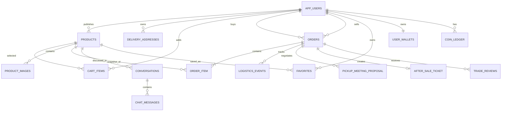

# StudentBay 数据库设计

> 文档版本：Day9 / v1.0  
> 数据库：MySQL，库名 `studentbay`  
> 字符集建议：`utf8mb4`  
> ORM：Spring Data JPA / Hibernate

## 1. 设计目标

数据库围绕“用户—商品—订单—履约—售后—治理”主链路设计，并兼顾校园场景中的单件库存、面交协商、双向取件码、聊天提醒、信誉评价和任务金币。

主要原则：

- 金额统一使用 `DECIMAL`，避免浮点误差；
- 时间统一由服务端写入 `DATETIME`；
- 状态字段保存枚举字符串，便于排查和答辩演示；
- 订单项保存标题和成交价快照，历史订单不依赖商品现值；
- 对重复操作建立唯一约束；
- 高频查询建立组合索引；
- 交易关键步骤在事务中执行，并对支付、取消、履约和售后使用悲观写锁；
- 当前多数跨聚合关联使用 `*_id` 逻辑外键，由服务层验证归属，降低二手商品删除/下架对历史数据的影响。

## 2. 数据源配置

开发运行配置位于 `src/main/resources/application.properties`：

```properties
spring.datasource.url=jdbc:mysql://localhost:3306/studentbay?useUnicode=true&characterEncoding=UTF-8&serverTimezone=Asia/Shanghai&allowPublicKeyRetrieval=true&useSSL=false
spring.datasource.username=${DB_USERNAME:studentbay}
spring.datasource.password=${DB_PASSWORD}
spring.jpa.hibernate.ddl-auto=update
```

自动化测试使用 H2 内存数据库的 MySQL 兼容模式，并使用 `create-drop` 保证用例隔离。

生产环境建议将 `ddl-auto` 改为 `validate`，通过 Flyway 或 Liquibase 管理版本化 DDL。

## 3. 数据域划分

| 数据域 | 表 |
|---|---|
| 用户与账户 | `app_users`、`delivery_addresses`、`user_activities` |
| 商品中心 | `products`、`product_images`、`categories`、`hot_keyword`、`product_browse`、`product_comments`、`price_cut_records` |
| 社交沟通 | `favorites`、`conversations`、`chat_messages`、`auto_reply_settings`、`reports` |
| 交易订单 | `cart_items`、`orders`、`order_item`、`coupons` |
| 履约售后 | `logistics_events`、`pickup_meeting_proposal`、`after_sale_ticket` |
| 信任评价 | `trade_reviews`、`transaction_ratings` |
| 激励任务 | `user_wallets`、`coin_ledger`、`task_claims`、`daily_game_progress` |
| 平台配置 | `campus_pois`、`app_config` |

当前模型共包含 29 张业务/集合表。

## 4. 核心实体关系



图中的关联多数是业务逻辑关系；数据库实体中只有 `order_item.order_id` 使用 JPA `ManyToOne` 物理关联，其余通过 ID 和服务层校验维护。

## 5. 表结构详细设计

### 5.1 `app_users` 用户表

| 字段 | 类型/约束 | 说明 |
|---|---|---|
| `id` | BIGINT PK AUTO_INCREMENT | 用户主键 |
| `email` | VARCHAR(120) NOT NULL UNIQUE | 登录邮箱 |
| `password_hash` | VARCHAR(64) NOT NULL | 密码哈希 |
| `display_name` | VARCHAR(60) NOT NULL | 显示名称 |
| `avatar_url` | VARCHAR(500) | 头像地址 |
| `university` | VARCHAR(80) | 学校名称 |
| `student_verified` | BOOLEAN NOT NULL | 校园身份认证标识 |
| `role` | VARCHAR(20) NOT NULL | `USER` / `ADMIN` |
| `status` | VARCHAR(20) NOT NULL | `ACTIVE` / `DISABLED` |
| `created_at` | DATETIME NOT NULL | 注册时间 |

### 5.2 `delivery_addresses` 收货地址表

| 字段 | 类型/约束 | 说明 |
|---|---|---|
| `id` | BIGINT PK | 地址 ID |
| `user_id` | BIGINT NOT NULL | 所属用户 |
| `recipient_name` | VARCHAR(60) NOT NULL | 收货人 |
| `phone` | VARCHAR(30) NOT NULL | 联系电话 |
| `detail` | VARCHAR(500) NOT NULL | 详细地址 |
| `latitude` / `longitude` | DOUBLE | 可选坐标 |
| `is_default` | BOOLEAN NOT NULL | 是否默认地址 |

业务规则：新增第一条地址自动设为默认；删除默认地址后自动选择剩余第一条。

### 5.3 `user_activities` 用户动态表

| 字段 | 类型/约束 | 说明 |
|---|---|---|
| `id` | BIGINT PK | 动态 ID |
| `user_id` | BIGINT NOT NULL | 用户 ID |
| `type` | VARCHAR(20) NOT NULL | `PUBLISH` / `SOLD` |
| `product_id` | BIGINT | 商品 ID |
| `title` | VARCHAR(200) NOT NULL | 商品标题快照 |
| `created_at` | DATETIME NOT NULL | 发生时间 |

索引：`idx_activity_user_time(user_id, created_at)`。

### 5.4 `products` 商品表

| 字段组 | 主要字段 | 说明 |
|---|---|---|
| 标识 | `id`、`seller_id` | 商品与卖家 |
| 基础信息 | `title VARCHAR(120)`、`description VARCHAR(2000)`、`category VARCHAR(40)`、`item_condition VARCHAR(40)` | 展示与筛选 |
| 价格 | `price DECIMAL(12,2)`、`original_price DECIMAL(12,2)` | 当前价与原价 |
| 图片 | `image_url VARCHAR(800)` | 主图；多图见 `product_images` |
| 地点 | `location_name`、`latitude DECIMAL(10,7)`、`longitude DECIMAL(10,7)`、`poi_id`、`address_detail` | 校园地点与坐标 |
| 结构化地址 | `address_country`、`address_province`、`address_city`、`address_district`、`address_street` | 发布定位 |
| 分类参数 | `brand`、`size`、`model`、`material`、`color`、`gender`、`sport_type` | 不同类别的扩展属性 |
| 教材参数 | `isbn`、`course_code`、`module_name` | 支持课程语境搜索 |
| 成色议价 | `condition_detail VARCHAR(500)`、`bargain_enabled` | 瑕疵说明与可议价 |
| 砍价 | `cut_enabled`、`cut_min DECIMAL(8,2)`、`cut_max DECIMAL(8,2)`、`cut_limit`、`cut_count` | “砍一刀”规则 |
| 运营 | `top_expire_at`、`sharpened_at` | 置顶与擦亮排序 |
| 自动回复 | `auto_reply_enabled`、`auto_reply_text VARCHAR(500)` | 商品级自动回复 |
| 状态统计 | `status VARCHAR(20)`、`view_count` | 生命周期与浏览量 |
| 审计 | `created_at`、`updated_at` | 创建/更新时间 |

索引：

- `idx_product_seller(seller_id)`；
- `idx_product_status_category(status, category)`。

状态：`AVAILABLE`、`RESERVED`、`SOLD`、`OFF_SHELF`、`DRAFT`。

### 5.5 `product_images` 商品图片集合表

| 字段 | 类型/约束 | 说明 |
|---|---|---|
| `product_id` | BIGINT NOT NULL | 所属商品 |
| `image_url` | VARCHAR(800) | 图片 URL |

由 `Product.images` 的 JPA `ElementCollection` 管理，第 1 张图片作为主要展示图。

### 5.6 `categories` 分类表

| 字段 | 类型/约束 | 说明 |
|---|---|---|
| `id` | BIGINT PK | 分类 ID |
| `name` | VARCHAR(40) NOT NULL UNIQUE | 分类名 |
| `parent_id` | BIGINT | 父分类；一级分类为空 |
| `icon` | VARCHAR(200) | 图标或 Emoji |
| `sort` | INT NOT NULL | 排序值 |
| `status` | VARCHAR(20) NOT NULL | `ENABLED` / `DISABLED` |
| `created_at` / `updated_at` | DATETIME NOT NULL | 审计时间 |

### 5.7 `hot_keyword` 热搜词表

| 字段 | 类型/约束 | 说明 |
|---|---|---|
| `id` | BIGINT PK | 主键 |
| `keyword` | VARCHAR(60) NOT NULL UNIQUE | 标准化关键词 |
| `count` | BIGINT NOT NULL | 搜索次数 |
| `updated_at` | DATETIME NOT NULL | 最近搜索时间 |

### 5.8 `product_browse` 浏览足迹表

| 字段 | 类型/约束 | 说明 |
|---|---|---|
| `id` | BIGINT PK | 主键 |
| `user_id` | BIGINT NOT NULL | 浏览用户 |
| `product_id` | BIGINT NOT NULL | 商品 |
| `viewed_at` | DATETIME NOT NULL | 最近浏览时间 |

唯一约束：`uk_browse_user_product(user_id, product_id)`，重复浏览更新同一行。

### 5.9 `product_comments` 商品留言表

字段：`id`、`product_id`、`user_id`、`content VARCHAR(500)`、`created_at`。  
索引：`idx_product_comment_product(product_id, created_at)`。

### 5.10 `price_cut_records` 砍价记录表

字段：`id`、`product_id`、`buyer_id`、`amount DECIMAL(8,2)`、`price_before DECIMAL(12,2)`、`price_after DECIMAL(12,2)`、`created_at`。  
唯一约束：`uk_price_cut_product_buyer(product_id, buyer_id)`，保证每人对同一商品只能砍一次。

### 5.11 `favorites` 收藏表

字段：`id`、`user_id`、`product_id`、`created_at`。  
唯一约束：`uk_favorite_user_product(user_id, product_id)`。

### 5.12 `cart_items` 购物车表

字段：`id`、`user_id`、`product_id`、`quantity`、`created_at`。  
唯一约束：`uk_cart_user_product(user_id, product_id)`。二手商品当前按单件库存处理，数量通常为 1。

### 5.13 `orders` 订单主表

| 字段组 | 字段 | 说明 |
|---|---|---|
| 标识 | `id`、`order_no VARCHAR(40) UNIQUE` | 主键与业务订单号 |
| 参与方 | `buyer_id`、`seller_id` | 买家与卖家 |
| 状态 | `status VARCHAR(30)`、`payment_status VARCHAR(20)`、`shipment_status VARCHAR(30)` | 订单、支付、物流状态 |
| 金额 | `product_amount`、`shipping_cost`、`discount_amount`、`coin_discount_amount`、`total_amount` | 全部为 `DECIMAL(12,2)` |
| 金币 | `coins_used` | 使用金币数 |
| 收货 | `shipping_method`、`shipping_address`、`recipient_name`、`recipient_phone` | 配送方式与下单快照 |
| 优惠支付 | `coupon_code`、`payment_method`、`payment_idempotency_key UNIQUE` | 支付上下文 |
| 支付时间 | `paid_at`、`payment_expires_at` | 支付成功与过期时间 |
| 取消 | `cancelled_at`、`cancellation_reason` | 取消审计 |
| 改价 | `price_adjusted_at`、`original_product_amount`、`original_shipping_cost`、`price_adjustment_count` | 异常改价风控依据 |
| 快递 | `courier_company`、`courier_name`、`courier_phone`、`pickup_time`、`tracking_number`、`pickup_code` | 快递履约 |
| 面交 | `pickup_location`、`pickup_meeting_start_at`、`pickup_meeting_end_at` | 当前正式安排 |
| 双向核验 | `buyer_pickup_code`、`seller_pickup_code`、`seller_handover_confirmed`、`buyer_receipt_confirmed` | 面交双方凭证 |
| 履约时间 | `estimated_delivery_at`、`shipped_at`、`received_at` | 物流和售后期限依据 |
| 审计 | `created_at`、`updated_at` | 创建与更新时间 |

索引：`idx_orders_buyer(buyer_id)`、`idx_orders_seller(seller_id)`。

订单状态：

- 履约：`PENDING_PAYMENT`、`PAID`、`COURIER_BOOKED`、`SHIPPED`、`COMPLETED`；
- 售后：`RETURN_REQUESTED`、`RETURN_APPROVED`、`INTERVENTION`、`REFUND_APPROVED`、`REFUNDED`；
- 终止：`CANCELLED`。

支付状态：`UNPAID`、`PAID`、`REFUNDED`。

### 5.14 `order_item` 订单项表

| 字段 | 类型/约束 | 说明 |
|---|---|---|
| `id` | BIGINT PK | 订单项 ID |
| `order_id` | BIGINT NOT NULL | 订单外键，由 JPA 维护 |
| `product_id` | BIGINT NOT NULL | 来源商品 ID |
| `product_title` | VARCHAR(200) NOT NULL | 标题快照 |
| `unit_price` | DECIMAL(12,2) NOT NULL | 成交单价快照 |
| `quantity` | INT NOT NULL | 数量 |
| `subtotal` | DECIMAL(12,2) NOT NULL | 小计 |

### 5.15 `coupons` 优惠券表

字段：`id`、`code VARCHAR(30) UNIQUE`、`name VARCHAR(80)`、`discount_amount DECIMAL(12,2)`、`minimum_amount DECIMAL(12,2)`、`enabled`、`owner_user_id`、`used`、`source VARCHAR(50)`、`expires_at`、`created_at`。

`owner_user_id` 为空表示公共优惠券；非空表示用户专属奖励券。

### 5.16 `logistics_events` 物流事件表

字段：`id`、`order_id`、`status VARCHAR(30)`、`title VARCHAR(100)`、`description VARCHAR(500)`、`location VARCHAR(160)`、`occurred_at`。  
索引：`idx_logistics_order_time(order_id, occurred_at)`。

物流状态：`BOOKED`、`PICKED_UP`、`IN_TRANSIT`、`AT_DESTINATION`、`OUT_FOR_DELIVERY`、`DELIVERED`。

### 5.17 `pickup_meeting_proposal` 面交协商表

| 字段 | 类型/约束 | 说明 |
|---|---|---|
| `id` | BIGINT PK | 提议 ID |
| `order_id` | BIGINT NOT NULL | 订单 |
| `proposer_id` / `responder_id` | BIGINT NOT NULL | 发起人与回应人 |
| `meeting_start_at` / `meeting_end_at` | DATETIME NOT NULL | 建议时间段 |
| `location` | VARCHAR(160) NOT NULL | 建议地点 |
| `status` | VARCHAR(20) NOT NULL | `PENDING` / `ACCEPTED` / `REJECTED` / `WITHDRAWN` |
| `conflict_warning` | VARCHAR(500) | 时间冲突说明 |
| `created_at` / `responded_at` | DATETIME | 创建与回应时间 |

索引：`idx_pickup_proposal_order(order_id)`、`idx_pickup_proposal_status(status)`。

### 5.18 `after_sale_ticket` 售后工单表

| 字段 | 类型/约束 | 说明 |
|---|---|---|
| `id` | BIGINT PK | 工单 ID |
| `work_order_no` | VARCHAR(40) NOT NULL UNIQUE | 工单号 |
| `order_id` | BIGINT NOT NULL UNIQUE | 一单最多一个正式工单 |
| `buyer_id` / `seller_id` | BIGINT NOT NULL | 责任双方快照 |
| `status` | VARCHAR(40) NOT NULL | 售后状态 |
| `previous_order_status` | VARCHAR(30) NOT NULL | 申请前履约状态，用于双轨展示和驳回恢复 |
| `reason` | VARCHAR(100) NOT NULL | 原因 |
| `description` | VARCHAR(1000) | 买家说明 |
| `seller_note` | VARCHAR(1000) | 卖家意见 |
| `intervention_reason` | VARCHAR(1000) | 介入原因 |
| `admin_note` | VARCHAR(1000) | 平台结论 |
| `refund_amount` | DECIMAL(12,2) NOT NULL | 退款金额 |
| `seller_reviewed_at`、`intervention_at`、`admin_reviewed_at`、`refunded_at` | DATETIME | 流程审计时间 |
| `created_at` / `updated_at` | DATETIME NOT NULL | 工单审计时间 |

索引：`idx_after_sale_status(status)`、`idx_after_sale_created(created_at)`。

状态：`REQUESTED`、`SELLER_APPROVED`、`SELLER_REJECTED`、`INTERVENTION_REQUESTED`、`REFUND_APPROVED`、`REFUND_REJECTED`、`REFUNDED`、`CLOSED`。

### 5.19 `conversations` 商品会话表

字段：`id`、`product_id`、`buyer_id`、`seller_id`、`updated_at`。  
唯一约束：`uk_conversation_product_buyer(product_id, buyer_id)`，同一买家与同一商品只建立一条持续会话。

### 5.20 `chat_messages` 消息表

字段：`id`、`conversation_id`、`sender_id`、`content VARCHAR(1000)`、`read_at`、`auto_reply`、`created_at`。  
索引：`idx_message_conversation(conversation_id, created_at)`。

订单售后事件使用结构化前缀写入 `content`，例如：

```text
[[ORDER_EVENT:AFTER_SALE_REQUESTED:123]]买家已提交售后申请
商品与描述不符
```

它既能复用现有会话未读统计，也能由前端渲染为独立订单提醒卡片。

### 5.21 `auto_reply_settings` 自动回复设置表

字段：`id`、`user_id UNIQUE`、`enabled`、`content VARCHAR(500)`、`updated_at`。商品表中的自动回复可覆盖用户全局设置。

### 5.22 `reports` 举报表

字段：`id`、`reporter_id`、`product_id`、`reason VARCHAR(80)`、`detail VARCHAR(1000)`、`status VARCHAR(20)`、`admin_note VARCHAR(1000)`、`created_at`。  
状态：`PENDING`、`RESOLVED`、`REJECTED`。

### 5.23 `trade_reviews` 双向交易评价表

字段：`id`、`order_id`、`product_id`、`reviewer_id`、`reviewee_id`、`review_type VARCHAR(30)`、`rating`、`content VARCHAR(500)`、`created_at`。

- 唯一约束：`uk_review_order_reviewer(order_id, reviewer_id)`；
- 索引：`idx_review_reviewee(reviewee_id, review_type)`、`idx_review_order(order_id)`；
- 类型：`BUYER_REVIEWS_SELLER`、`SELLER_REVIEWS_BUYER`。

### 5.24 `transaction_ratings` 兼容评分表

字段：`id`、`order_id`、`rater_id`、`target_user_id`、`score`、`comment VARCHAR(300)`、`created_at`。

- 唯一约束：`uk_rating_order_rater(order_id, rater_id)`；
- 索引：`idx_rating_target(target_user_id, created_at)`。

Trust Score 会合并 `trade_reviews` 与兼容评分，并按订单与评价人去重。

### 5.25 `user_wallets` 金币钱包表

字段：`user_id PK`、`coin_balance`、`created_at`、`updated_at`。用户与钱包是一对一关系。

### 5.26 `coin_ledger` 金币流水表

字段：`id`、`user_id`、`amount`、`type VARCHAR(40)`、`description VARCHAR(160)`、`created_at`。  
索引：`idx_coin_ledger_user_time(user_id, created_at)`。

余额变化与流水应在同一事务中保存，便于追踪奖励和抵扣。

### 5.27 `task_claims` 任务领取表

字段：`id`、`user_id`、`task_code VARCHAR(50)`、`claim_date DATE`、`reward_coins`、`created_at`。  
唯一约束：`uk_task_claim_user_code_date(user_id, task_code, claim_date)`，防止每日任务重复领取。

### 5.28 `daily_game_progress` 每日寻宝进度表

字段：`id`、`user_id`、`game_date DATE`、`position`、`rolls_used`、`coins_earned`、`updated_at`。  
唯一约束：`uk_daily_game_user_date(user_id, game_date)`。

### 5.29 `campus_pois` 与 `app_config`

`campus_pois` 保存校园地点：`id`、`name`、`address`、`latitude DECIMAL(10,7)`、`longitude DECIMAL(10,7)`、`category`、`sort`、`enabled`。索引为 `idx_poi_enabled_sort(enabled, sort)`。

`app_config` 是键值配置表：`config_key VARCHAR(80) PK`、`config_value VARCHAR(1000)`，当前用于地图中心、缩放级别、瓦片地址和地理编码 Key。

## 6. 数据一致性与并发

### 6.1 订单创建

一次结算在事务中完成：校验购物车归属与商品状态、按卖家分组、创建订单和订单项、将商品设为预订、删除购物车项、使用优惠券和金币。

### 6.2 支付幂等

`payment_idempotency_key` 建立唯一约束；支付服务通过 `SELECT ... FOR UPDATE` 对订单加悲观写锁。同一个幂等键重复提交返回已有结果，不重复记账或重复生成卖家动态。

### 6.3 售后与发货互斥

售后申请和卖家履约均读取带写锁的订单。售后将主状态置为 `RETURN_REQUESTED` 后，快递预约或发货的状态前置条件不再满足，因此陈旧页面按钮也无法写入冲突状态。

### 6.4 超时恢复

定时任务扫描超时 `PENDING_PAYMENT` 订单：

- 订单改为 `CANCELLED`；
- `RESERVED` 商品恢复 `AVAILABLE`；
- 退回订单金币；
- 恢复用户专属优惠券可用状态。

## 7. 索引与查询建议

现有索引覆盖卖家商品、商品状态分类、买卖双方订单、会话消息、用户动态、物流事件、售后状态和评价对象。数据量扩大后建议增加：

- `orders(status, created_at)`：超时扫描和管理统计；
- `orders(payment_status, created_at)`：GMV 统计；
- `reports(status, created_at)`：待处理举报队列；
- `products(status, top_expire_at, sharpened_at, created_at)`：首页排序；
- 对商品标题、描述、ISBN、课程号建立 MySQL FULLTEXT 或接入搜索引擎。

## 8. 数据安全与隐私

- 数据库账号仅授权 `studentbay` 库，不使用 root 运行应用；
- MySQL 端口不向校园网公开，仅应用端口对内提供访问；
- 数据库密码、AI Key 和支付密钥使用环境变量；
- 电话、地址和双向取件码只向订单参与方返回；
- `OrderResponse.myPickupCode` 根据查看者动态选择，只返回本人的码；
- 历史订单保留必要交易快照，删除商品不应级联删除订单记录；
- 正式部署需增加定期备份、恢复演练、脱敏日志和管理员操作审计。

## 9. 建库与查看方式

```sql
CREATE DATABASE IF NOT EXISTS studentbay
CHARACTER SET utf8mb4
COLLATE utf8mb4_0900_ai_ci;
```

应用首次启动后 Hibernate 会按实体创建或更新表。可在 IntelliJ IDEA Database 工具窗口连接：

```text
Host: localhost
Port: 3306
Database: studentbay
User: studentbay
Password: 与 DB_PASSWORD 一致
```

常用检查语句：

```sql
USE studentbay;
SHOW TABLES;
DESCRIBE orders;
SELECT id, order_no, buyer_id, seller_id, shipping_method, status, payment_status
FROM orders
ORDER BY created_at DESC;
SELECT work_order_no, order_id, previous_order_status, status, refund_amount
FROM after_sale_ticket
ORDER BY created_at DESC;
```
