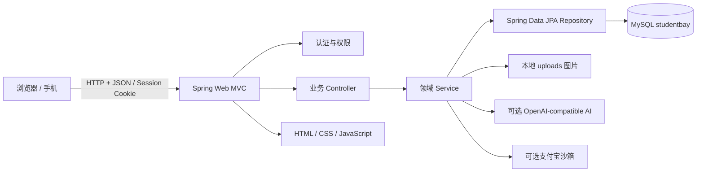
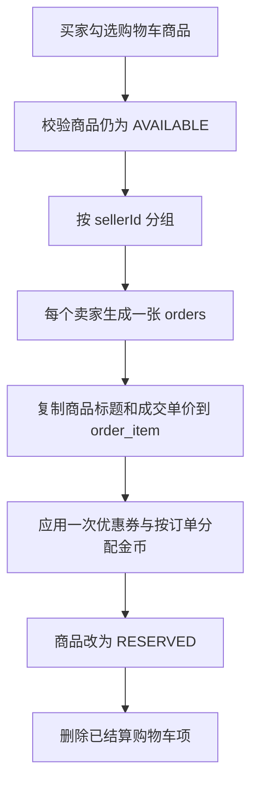
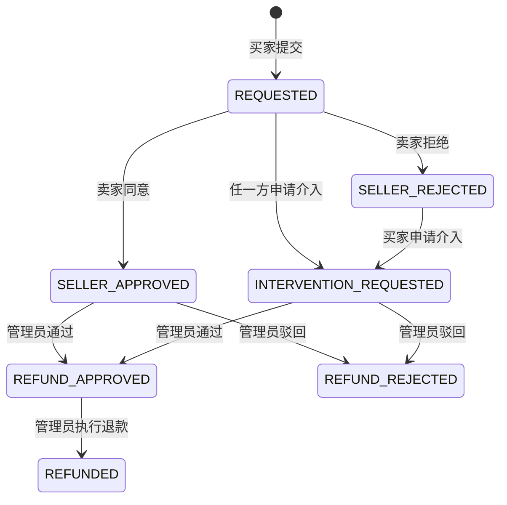

# StudentBay 系统设计说明书

> 文档版本：Day9 / v1.0  
> 编制日期：2026-09-08  
> 适用代码：`user1` 分支当前版本  
> 项目定位：面向高校内部可信场景的校园闲置物品交易平台

## 1. 文档目的

本文说明 StudentBay 的系统目标、总体架构、模块边界、核心业务流程、状态模型、安全策略、用户体验设计和部署方案，为项目答辩、后续开发、联调测试与维护提供统一依据。

StudentBay 不只是“商品发布 + 下单”的演示程序，而是围绕校园二手交易的完整闭环进行设计：从发现商品、智能搜索、咨询议价、购物车拆单、支付、面交或快递履约，到评价、信誉评分、退款、平台介入及管理员治理，均由同一套订单与权限模型贯通。

## 2. 建设背景与目标

校园闲置交易具有距离近、单件库存、面交比例高、交易金额较小但信任成本高等特点。通用电商系统直接用于校园场景时，常出现以下问题：

- 商品信息与课程、校区、宿舍生活的匹配度不足；
- 买卖双方约见时间容易冲突，缺少双向确认；
- 同一购物车包含多个卖家，不能按普通单商户订单处理；
- 面交没有可核验的交付凭证；
- 退款、举报、评价和信誉信息彼此割裂；
- 页面只展示“状态文字”，缺少清晰的下一步行动提示。

StudentBay 的建设目标如下：

1. 建立适配校园语境的商品发现与自然语言搜索能力。
2. 建立单件库存、按卖家拆单、支付幂等和超时释放机制。
3. 同时支持校园面交与快递配送，并保证双方看到同一订单事实。
4. 提供正式售后工单、卖家审核、平台介入和退款执行闭环。
5. 通过校园认证、成交、评分和举报生成 Trust Score，降低陌生交易风险。
6. 提供完整的管理员数据面板和内容治理入口。
7. 以高质量交互、响应式布局和动效提升用户体验，同时保证按钮可用性和无障碍降级。

## 3. 用户角色

| 角色 | 主要职责与权限 |
|---|---|
| 游客 | 浏览在售商品、查看分类、价格对照和公共地图配置；不能收藏、聊天、下单或发布 |
| 注册用户/买家 | 登录、维护资料与地址、收藏、咨询、加入购物车、结算、支付、确认收货、申请售后、评价 |
| 注册用户/卖家 | 发布和维护商品、查看卖出订单、改价、处理面交/快递履约、审核售后、评价买家 |
| 管理员 | 查看经营数据、管理用户与商品、处理举报、审核售后、执行退款、维护地图配置 |

同一个普通用户可同时是买家和卖家；权限不是固定页面角色，而是根据当前资源的 `buyerId`、`sellerId` 与登录用户 ID 动态判断。

## 4. 项目优势与创新点

### 4.1 面向校园场景的交易模型

- 商品是二手单件库存，下单后立即由 `AVAILABLE` 进入 `RESERVED`，避免重复售卖。
- 一次购物车结算允许选择多个卖家的商品，后端按 `sellerId` 自动拆分为多张子订单。
- 面交订单零运费，并保存独立的日期、起止时间和校园地点。
- 快递订单提供预约取件、隐私号码、运单、预计送达和物流轨迹。

### 4.2 双向取件码与面交协商

- 每张面交订单生成买家取件码和卖家交付码。
- 卖家验证买家取件码后确认交付，买家验证卖家交付码后确认收货。
- 买卖双方均可提出新的面交时间和地点，只有对方接受后才覆盖正式安排。
- 系统检查同一参与者已有面交订单，给出时间冲突提醒。

### 4.3 AI 辅助自然语言找商品

用户可直接输入“预算 150 元，想买适合宿舍用的安静键盘，最好能面交”。系统解析预算、类别、成色、关键词和面交偏好，再对真实商品进行筛选与相关度排序。

- 配置 AI 服务时使用 OpenAI-compatible 接口进行意图解析；
- 未配置或外部服务不可用时自动回退到本地语义规则；
- AI 只负责结构化理解，最终结果仍来自本地数据库，不会虚构商品；
- 响应中的 `mode` 明确标识 `AI_ASSISTED` 或 `LOCAL_FALLBACK`，便于解释和调试。

### 4.4 Trust Score 与交易风险提示

Trust Score 综合校园认证、成功交易、双方评分和有效举报等信号。付款前的风险检查还会识别：

- 大额交易；
- 买家近期频繁取消；
- 卖家对待付款订单异常或频繁改价；
- 交易对手信誉分偏低。

系统采用“提示与解释”而不是简单拦截，既降低风险，也避免影响正常校园交易。

### 4.5 正式售后闭环

买家付款后即可申请退款/退货；确认收货超过 7 天后关闭普通售后入口。流程包含：

```text
买家提交申请
  → 卖家审核
  → 双方协商
  → 必要时申请平台介入
  → 管理员审核
  → 执行退款并释放商品
```

Day9 同步机制进一步保证：售后提交后自动向订单关联会话写入未读提醒；订单列表在窗口重新聚焦或每 15 秒自动刷新；售后进行中禁止继续快递发货；履约进度与售后进度分开呈现。

### 4.6 价格保护与循环激励

- 结算前展示同分类相似商品的最低价、均价、最高价和当前价格偏差。
- 支持优惠券与金币抵扣；一次购买三件商品可获得后续循环购奖励券。
- 任务中心包含每日任务、成长任务、签到和掷骰子校园寻宝，以非现金金币提升用户活跃度。

### 4.7 完整的平台治理能力

管理员面板提供日期范围筛选、订单状态统计、GMV、活跃/停用/认证用户、待处理举报、退款、平台介入和分类成交分析。管理员可对用户、商品、举报和售后工单进行处理，形成交易平台而非单纯信息展示站。

## 5. 总体架构

### 5.1 技术架构



### 5.2 技术选型

| 层次 | 技术 | 选择理由 |
|---|---|---|
| 后端 | Java 17、Spring Boot 4.1.1 | 生态成熟，适合课程项目快速构建可维护业务系统 |
| Web | Spring Web MVC、Jakarta Validation | REST API、参数校验、统一异常处理 |
| 持久化 | Spring Data JPA、Hibernate | 实体驱动建模，减少重复 DAO 代码 |
| 生产数据库 | MySQL 8/9 | 支持事务、索引、唯一约束和校园网本地部署 |
| 测试数据库 | H2 MySQL Mode | 测试隔离，不依赖开发机 MySQL |
| 前端 | 原生 HTML、CSS、JavaScript | 无额外构建链，部署简单，适合校园内网 |
| 地图 | Leaflet + 可配置瓦片/地理编码 | 地图提供方与中心点可由管理员配置 |
| 支付 | 本地模拟 + 支付宝沙箱 | 演示环境安全，保留外部支付联调能力 |
| AI | OpenAI-compatible REST + 本地回退 | 可接云端模型或本地 Ollama，同时保证离线可用 |

### 5.3 分层职责

- `controller`：接收 HTTP 请求、校验参数、读取 Session、返回统一响应。
- `service`：订单状态机、拆单、支付、售后、信誉、风险、任务奖励等核心规则。
- `repository`：数据库查询、悲观锁与统计查询。
- `entity`：持久化实体、枚举状态、唯一约束与索引。
- `dto`：隔离接口字段与实体，实现请求校验和响应裁剪。
- `static`：多页面界面、前端状态渲染、表单交互和响应式动效。
- `config`：演示数据、定时任务、上传资源映射。

## 6. 功能模块设计

| 模块 | 核心能力 | 关键数据 |
|---|---|---|
| 认证账户 | 注册、登录、退出、资料、头像、密码、校园认证标识 | `app_users`、HTTP Session |
| 商品中心 | 分类、发布、草稿、上下架、多图、砍价、议价、置顶、擦亮、搜索、推荐 | `products`、`product_images`、`categories` |
| 商品发现 | 分类筛选、价格区间、分页、热搜、自然语言搜索、浏览足迹、价格比较 | `hot_keyword`、`product_browse` |
| 社交互动 | 收藏、公开留言、商品会话、自动回复、未读消息 | `favorites`、`product_comments`、`conversations`、`chat_messages` |
| 购物车 | 单件商品加入、移除、数量与计数 | `cart_items` |
| 订单结算 | 地址、优惠券、金币、按卖家拆单、商品预订 | `delivery_addresses`、`coupons`、`orders`、`order_item` |
| 支付 | 模拟支付、支付宝沙箱、金额核对、幂等键 | `orders.payment_*` |
| 履约 | 面交双码、协商改期、快递预约、发货、物流、收货 | `pickup_meeting_proposal`、`logistics_events` |
| 售后 | 退款/退货申请、卖家审核、介入、管理员审核、退款 | `after_sale_ticket` |
| 信任风控 | Trust Score、交易评分、评价、大额/取消/改价风险 | `transaction_ratings`、`trade_reviews`、`reports` |
| 激励中心 | 钱包、金币流水、每日任务、掷骰子寻宝、奖励券 | `user_wallets`、`coin_ledger`、`task_claims`、`daily_game_progress` |
| 管理后台 | 数据分析、用户、商品、举报、售后、地图配置 | 多业务表、`app_config` |

## 7. 核心业务流程

### 7.1 商品发布与发现

1. 卖家选择分类并填写分类特有参数，如 ISBN、课程号、型号、尺码或材质。
2. 图片可本地上传或使用 URL，商品支持主图和多图。
3. 商品可保存为 `DRAFT`，正式发布后为 `AVAILABLE`。
4. 首页按关键词、分类、成色、价格和排序方式查询；搜索词同步累计到热搜。
5. 登录用户浏览他人商品时记录足迹，重复浏览只更新时间。
6. 详情页展示卖家 Trust Score、价格对比、相似推荐、留言和交易地点。

### 7.2 购物车与按卖家拆单



拆单后每张订单独立支付、履约、售后和评价，避免不同卖家的物流及责任边界混在一起。

### 7.3 支付与幂等

1. 创建订单时写入 `paymentExpiresAt`。
2. 支付请求必须携带不超过 80 字符的 `idempotencyKey`。
3. 后端对订单加悲观写锁，避免并发支付。
4. 相同幂等键重复请求返回第一次成功结果；不同幂等键对已付款订单返回冲突。
5. 支付金额必须与订单应付金额一致，外部支付回调还需验签。
6. 定时任务扫描超时未支付订单，将其取消并释放 `RESERVED` 商品、金币和优惠券。

### 7.4 校园面交

```text
PENDING_PAYMENT → PAID → SHIPPED → COMPLETED
```

- 结算时保存面交日期、开始时间、结束时间和地点。
- 双方可以在付款前或待交付阶段提出修改；旧的待处理提议会被撤回。
- 接受提议时更新订单正式安排；冲突仅提醒，不替代双方判断。
- 卖家输入买家取件码确认交付，买家输入卖家交付码确认收货。

### 7.5 快递配送

```text
PENDING_PAYMENT → PAID → COURIER_BOOKED → SHIPPED → COMPLETED
```

- 买家结算时选择属于自己的地址，订单保存收件信息快照。
- 卖家预约快递后生成模拟快递员、隐私号码、取件码和预计送达时间。
- 填写运单并确认发货后产生揽收与运输事件。
- 买家可同步模拟物流进度并最终确认收货。

### 7.6 售后与退款

售后状态与履约状态分别表达：`orders.status` 表示当前主流程，`after_sale_ticket.previous_order_status` 保存申请前履约状态。界面同时展示两条信息，防止出现“售后处理中就误认为已经完成配送”的问题。



售后开始后，卖家不能继续预约或确认快递发货；申请、审核和介入动作会同步到订单关联聊天会话，并进入对方未读计数。

## 8. 状态与一致性设计

### 8.1 商品状态

| 状态 | 含义 |
|---|---|
| `DRAFT` | 草稿，仅卖家本人可见 |
| `AVAILABLE` | 可购买 |
| `RESERVED` | 已下单预订，等待支付或履约 |
| `SOLD` | 交易完成 |
| `OFF_SHELF` | 主动或管理员下架 |

### 8.2 订单状态

`PENDING_PAYMENT`、`PAID`、`COURIER_BOOKED`、`SHIPPED`、`COMPLETED`、`RETURN_REQUESTED`、`RETURN_APPROVED`、`INTERVENTION`、`REFUND_APPROVED`、`REFUNDED`、`CANCELLED`。

### 8.3 一致性措施

- 订单、商品预订、购物车删除在同一事务中完成。
- 支付、取消、卖家履约和售后申请使用数据库写锁保护关键状态跳转。
- 唯一约束防止重复收藏、重复加购、重复评分、重复砍价和重复售后工单。
- 订单项保存商品标题与成交价快照，商品后续修改不会影响历史订单。
- 双端页面从同一个订单 API 读取，定时刷新与窗口聚焦刷新减少陈旧界面。
- 后端始终再次校验状态与资源归属，前端旧按钮不能绕过规则。

## 9. 权限与安全设计

- 登录态使用服务端 HTTP Session；Cookie 设置 `HttpOnly` 和 `SameSite=Lax`。
- 所有个人数据接口通过 `CurrentUserService` 获取当前用户，不信任前端提交的用户 ID。
- 订单仅买卖双方可查看；改价仅卖家、取消仅买家、售后申请仅买家、退款仅管理员。
- 管理员接口统一校验 `ADMIN` 角色。
- 密码以 SHA-256 哈希保存；生产化时建议升级为 BCrypt/Argon2 并加入随机盐。
- 上传限制文件大小和扩展名，文件名由服务端生成。
- 输出页面前对用户文本进行 HTML 转义，降低 XSS 风险。
- 支付宝密钥、数据库密码和 AI Key 仅通过环境变量配置，不写入仓库。
- 外部支付回调执行签名与金额校验，支付请求执行幂等校验。

## 10. 用户体验设计

### 10.1 视觉与交互

- 首页采用非对称商品视觉、层叠卡片、瀑布布局和滚动渐入。
- 订单详情采用时间线表达，面交安排、双向取件码和售后工单分层展示。
- 支付过程显示 `Processing payment...`，完成后展示勾选成功动画。
- 管理后台使用指标卡、趋势图和分类成交图形，减少纯表格阅读负担。
- 消息页把商品、价格、订单状态和操作固定在会话上下文中。

### 10.2 可用性保障

- 支持桌面端和移动端响应式布局。
- 使用 `prefers-color-scheme`/主题变量支持浅色和深色模式。
- 使用 `prefers-reduced-motion` 为不适合动画的用户关闭大幅运动。
- 动效层使用 `pointer-events: none`，避免遮挡按钮。
- 提交按钮在请求期间禁用，防止连续点击；后端仍执行幂等和状态校验。
- 状态不仅用颜色表达，还配合文字、图标和下一步操作。

## 11. 异常处理与可观测性

API 使用统一结构：

```json
{"code": 200, "message": "success", "data": {}}
```

- 业务异常映射为准确的 HTTP 状态码，如 `400`、`401`、`403`、`404`、`409`。
- 参数校验失败返回具体字段和原因。
- 页面统一捕获接口错误并以 Toast 告知用户。
- 管理后台集中展示待举报、待售后与介入数量。
- 当前日志由 Spring Boot 输出；正式部署建议增加请求 ID、结构化日志和操作审计表。

## 12. 部署设计

### 12.1 本地/校园网部署

- 应用默认监听 `0.0.0.0:8080`。
- MySQL 只需在应用主机本地开放，不应暴露 `3306` 给校园网。
- 同一网络用户通过 `http://主机校园网IP:8080` 访问。
- `scripts/start-lan.sh` 用于构建、读取数据库密码并启动服务。

### 12.2 关键环境变量

| 环境变量 | 作用 |
|---|---|
| `DB_USERNAME`、`DB_PASSWORD` | MySQL 登录信息 |
| `SERVER_ADDRESS`、`SERVER_PORT` | 服务监听地址与端口 |
| `ORDER_PAYMENT_TIMEOUT_MINUTES` | 未付款订单超时时间 |
| `ALIPAY_SANDBOX_ENABLED`、`ALIPAY_*` | 支付宝沙箱配置 |
| `AI_SEARCH_ENABLED`、`AI_BASE_URL`、`AI_API_KEY`、`AI_MODEL` | AI 搜索解析器配置 |
| `APP_BASE_URL` | 外部支付回跳地址 |

长期部署建议由学校提供固定内网服务器与 DNS，增加 HTTPS、反向代理、数据库备份、上传文件备份和密钥管理。

## 13. 测试设计

项目使用 JUnit 5、Spring Boot Test、MockMvc 与 H2 MySQL Mode，覆盖：

- Spring 上下文与演示数据初始化；
- 登录、商品发布、筛选、评论、收藏、聊天和地址；
- 购物车拆单、支付幂等、取消与超时释放；
- 面交双码、面交时间冲突、快递物流；
- 付款后退款、7 天售后期限、卖家审核、平台介入和管理员退款；
- 买卖双方配送方式与售后状态一致、卖家未读售后提醒；
- Trust Score、风险提示、AI 搜索和支付宝配置状态；
- 静态页面和关键 DOM 元素存在性。

运行方式：

```bash
./mvnw test
```

## 14. 已知边界与后续演进

当前版本适用于课程答辩、功能验证和校园内网试用。进一步生产化建议：

1. 将密码算法升级为 BCrypt/Argon2，并增加邮箱验证码和密码找回。
2. 使用 Flyway/Liquibase 管理数据库版本，替代生产环境 `ddl-auto=update`。
3. 增加 WebSocket/SSE，将 15 秒轮询升级为实时订单与消息推送。
4. 将上传迁移到对象存储，并接入图片内容审核。
5. 引入 Redis 保存 Session、限流、热搜和幂等结果。
6. 增加独立支付流水、退款流水和管理员操作审计。
7. 对 AI 搜索增加评测集、超时熔断、内容安全和调用成本监控。

## 15. 总结

StudentBay 的核心竞争力是“校园语境 + 完整交易闭环 + 可解释信任体系 + 高质量体验”。它既具备商品平台的基础能力，也解决了校园面交协商、双向取件、多卖家拆单、超时释放、退款介入和交易风控等更接近真实业务的问题，并通过自动化测试保证关键状态在买卖双方和管理员之间保持一致。
