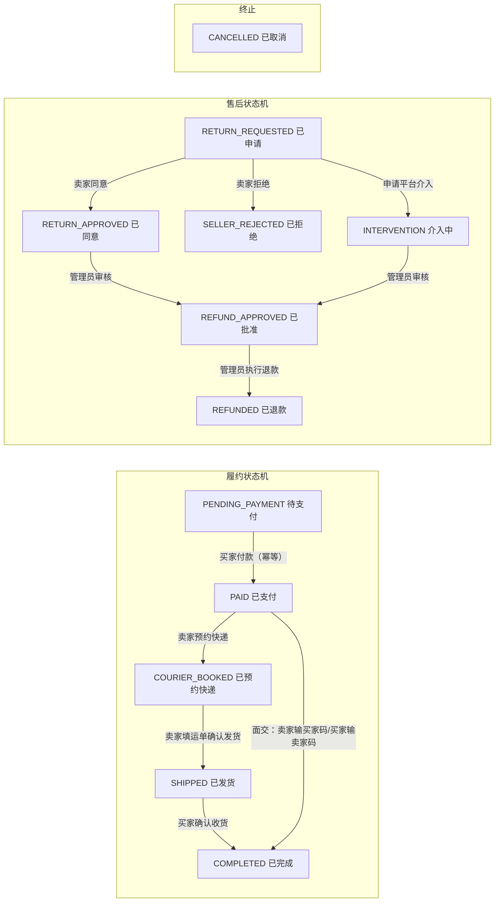

# StudentBay 校园二手交易平台需求说明书

---

## 1. 背景与目标

### 1.1 平台背景

StudentBay 是面向高校学生的校园二手交易平台，使用 Spring Boot、Spring Data JPA、MySQL 与原生 HTML/CSS/JavaScript 实现。前端采用多页面业务流程，交易、卖家履约、咨询和管理功能彼此独立。

平台定位是专为大学生设计的二手物品交易数字平台，帮助学生省钱购买二手课本、电子产品、家具等必需品，允许学生互相广告与交换从课程教材、笔记本电脑到迷你冰箱、自行车等各类物品。

### 1.2 开发目标

团队从零开发 StudentBay，开发时须聚焦以下三大关键领域：

| 关键领域 | 关注要点（课程文档原文） |
|---|---|
| **商品发现**（Item Discovery） | 用户需要高效的方式找到特定物品，尤其是课程教材；搜索功能应直观且全面。 |
| **商品管理**（Item Management） | 系统需要顺畅地跟踪商品可用性，并在可行处收集反馈。 |
| **信任与安全**（Trust and Safety） | 在用户间建立信任：大学邮箱验证、可选的学生/教职工证件校验、资料完整度指标，以及来自此前买卖双方的可见评价历史。 |

### 1.3 实现口径

- 首次启动会自动创建演示数据，演示账号密码均为 `123456`：买家 `lin@campus.edu`、卖家 `chen@campus.edu`、管理员 `admin@studentbay.local`。
- 账号身份约束：学生账号邮箱以 `@xxx.edu` 结尾，管理员账号邮箱以 `@xxx.local` 结尾，登录、注册、修改资料三条入口统一校验。
- 本地运行入口为 `http://localhost:8080/`，数据库使用本地 MySQL（库名 `studentbay`，utf8mb4）。
- 自动化测试使用 H2 内存库，不依赖本地 MySQL，通过 `./mvnw test` 运行。

---

## 2. 范围与边界

### 2.1 交易边界

| 规则 | 说明 |
|---|---|
| **二手单品** | 商品为校园二手单品，同一商品进入结算后状态变为 `RESERVED`。 |
| **独立订单** | 购物车可同时选择多件商品；结算时按卖家（sellerId）拆分为独立订单，便于不同卖家分别履约。 |
| **优惠券规则** | 优惠券只应用到首个满足门槛的商品订单；公共优惠券人人可用，用户专属券归指定用户。 |
| **配送费规则** | 快递配送按订单收取配送费；校内自提（面交）不收配送费。 |
| **双履约模式** | 支持「校园面交」（PICKUP）与「快递配送」（DELIVERY）两种履约方式；面交通过双向取件码核验交付。 |

### 2.2 订单状态与交互逻辑



**职责划分**：买家负责提交订单、付款、确认收货；卖家负责预约快递、填写运单、确认发货、面交核验；订单所属用户之外无法查看或改变订单。售后进行中禁止卖家继续预约快递或确认发货（后端状态机拦截）。

### 2.3 物流状态

- 物流状态：`BOOKED`（已预约）→ `PICKED_UP`（已揽收）→ `IN_TRANSIT`（运输中）→ `AT_DESTINATION`（已到站）→ `OUT_FOR_DELIVERY`（派送中）→ `DELIVERED`（已签收）。
- 预约成功后生成快递员、隐私号码、预计取件时间与六位取件码；确认发货后记录揽收、运输、到站、派送与签收轨迹（logistics_events）。
- 买卖双方均可查看物流，只有卖家可以在预约取件后填写运单并确认发货。
- 面交模式使用双向取件码：卖家输入买家码确认交付（confirm-pickup-handover），买家输入卖家码确认收货（confirm-receipt）；`myPickupCode` 只返回当前查看者自己的码。

### 2.4 消息边界

- 会话由「商品 + 买家 + 卖家」唯一确定；同一买家与同一商品只建立一条持续会话。
- 买家列表展示「我咨询的商品」，卖家列表展示「别人咨询我的商品」；打开会话后，将对方发送且未读的消息标记为已读；提供全部会话未读总数。
- 订单售后事件以结构化前缀（`[[ORDER_EVENT:AFTER_SALE_REQUESTED:123]]`）写入会话消息，前端渲染为独立订单提醒卡片，并计入未读。
- 会话接口同时返回商品信息与最近订单摘要（productStatus、order.status、canCancel、canAdjustPrice、canRequestRefund 等），使聊天、商品与交易状态保持同一上下文。

### 2.5 地图配置边界

- 公共地图中心点、缩放级别、瓦片地址和版权标注保存在 `app_config` 表，可由管理员调整。
- 发布页保存商品位置经纬度，详情页只展示该商品的交易位置。

### 2.6 模块与分工边界

| 模块 | 职责 |
|---|---|
| **交易核心（user1）** | 购物车、订单履约、支付、售后、物流、面交协商 |
| **商品中心（user2）** | 商品发布、搜索（含自然语言搜索）、上下架、图片上传、商品管理、智能回复、AI 描述优化 |
| **个人中心与设置（user3）** | 我的空间（宝贝/评价/动态）、设置中心（个人信息、地址、密码、主题）、邮箱域校验、电话打码 |
| **管理后台** | 用户状态、商品上下架、举报处理、售后工单审核与退款、数据面板、地图配置 |

### 2.7 与课程需求（FR1–FR6）的对应关系

| FR | 课程需求要点 | g3 文档中的实现/对应情况 |
|---|---|---|
| **FR1** | 用户档案与验证：大学邮箱（如 .edu 域）为主验证方式并需邮件确认；档案展示信任指标（验证状态、加入日期、成功销售数、平均评分、资料完整度百分比）；三级会员（公开成员/学生成员/关联成员） | 已实现校园账号登录、身份认证标识（studentVerified）与会话登录态；邮箱域统一校验（学生 `@xxx.edu`、管理员 `@xxx.local`）。<span style="color:orange">邮件确认、三级会员、资料完整度百分比在 g3 文档中未定义，待确认</span> |
| **FR2** | 商品上架：最多 5 张图、详细描述、成色等级、标价；浏览量计数；分类专属字段（教材：ISBN/课程代码/模块名/版次/作者等） | 已实现：多图 ≤5 张（T1.1）、分类动态参数（T4.3）、成色说明与议价（T4.7）、浏览量计数、AI 描述优化（T5.7） |
| **FR3** | 搜索与发现：关键词、分类、价格区间、成色筛选；教材支持课程代码、模块名、ISBN 检索；结果展示缩略图、价格、卖家评分、发布时间、浏览量 | 已实现：分页/价格区间/教材检索/热搜（T4.2）、分类 Tab（T4.1）；另有自然语言搜索（AI_ASSISTED / LOCAL_FALLBACK） |
| **FR4** | 关注列表与通知：收藏跟踪；降价、状态变化、新匹配商品时发送邮件通知 | 已实现收藏、消息未读提醒、订单事件通知。|
| **FR5** | 商品状态管理：Available / Reserved / Sold 三态；卖家标记已售时选择买家或标记非系统用户；系统维护完整记录 | 已实现 AVAILABLE / RESERVED / SOLD / OFF_SHELF / DRAFT 五态（T2.3）；商品进入结算自动 RESERVED，订单完成后 SOLD |
| **FR6** | 评分与评论：交易完成后买家可给 1–5 星与可选文字反馈（最多 1000 字）；评价永久加入卖家档案；同一笔交易仅评价一次 | 已实现双向评价（买家评价卖家 / 卖家评价买家，BUYER_REVIEWS_SELLER / SELLER_REVIEWS_BUYER），评价汇总（总数+平均星级），按订单+评价人去重；评价内容上限 500 字。非注册买家想要进行商品咨询与商品购买均需要先成为注册用户 |

---

## 3. 用户与场景

### 3.1 用户角色

依据 README 演示账号，平台存在三类角色：

| 角色 | 演示账号 | 职责/场景 |
|---|---|---|
| **买家** | `lin@campus.edu` | 浏览商品、咨询、下单、付款、确认收货、申请售后 |
| **卖家** | `chen@campus.edu` | 发布商品、履约（预约快递/面交核验、发货）、审核售后 |
| **管理员** | `admin@studentbay.local` | 管理后台：用户状态、商品上下架、举报处理、售后审核退款、数据面板、地图配置 |

### 3.2 会员分级（课程要求 vs 当前实现）

课程文档 FR1 提出三级会员体系：

| 会员层级 | 权限与验证（课程文档原文） |
|---|---|
| **公开成员**（Public Members） | 仅查看访问，无需验证。 |
| **学生成员**（Student Members） | 完整买卖权限，通过大学邮箱验证。 |
| **关联成员**（Affiliated Members） | 大学教职工，通过机构教职工邮箱验证，完整买卖权限。 |


### 3.3 核心使用场景

#### 3.3.1 买家流程

```
商品列表 → 商品详情 → 加入购物车 → 结算（快递/面交） → 支付 → 买家订单 → 确认收货/售后
```

#### 3.3.2 卖家流程

```
发布商品 → 收到已付款订单 → 预约快递/面交核验 → 填写运单并确认发货 → 审核售后
```

#### 3.3.3 咨询与治理

商品详情可以发起商品专属会话或提交举报；预约快递后可进入独立物流详情页；售后申请通过订单事件消息触达卖家；管理后台可处理用户、商品、举报、售后工单与地图配置，并提供数据面板。

---

## 4. 功能需求与交互逻辑

### 4.1 账号与身份

**功能**：注册、登录、会话登录态、身份认证标识（studentVerified）、资料与头像管理、修改密码、邮箱域统一校验。

**交互逻辑**：

- 登录/注册/修改资料三入口执行同一套邮箱域校验：学生账号必须 `@xxx.edu`，管理员账号必须 `@xxx.local`，其余邮箱一律拒绝并返回明确提示（400）。
- 注册表单角色下拉切换时，邮箱输入框的校验规则与提示文案实时联动；前端 pattern + setCustomValidity 即时反馈，提交前再做拦截，形成「输入即提示 + 提交再拦截」双层防护。
- 修改密码需输入原密码（oldPassword）验证通过后才能设置新密码（6–64 位）。
- 收货电话：结算页与设置中心地址表单统一 `maxlength=11`、`inputmode=numeric`、`pattern="[0-9]{11}"`；列表展示时中间四位打码（`138****xxxx`），编辑时用完整号码。

### 4.2 商品中心

#### 4.2.1 商品发布

| 子功能 | 需求与交互逻辑 |
|---|---|
| **图片多方式上传**（T1.1/T4.8） | 发布页商品图片升级为九宫格，最多 5 张，第 1 张为主图，支持四种来源混合：本地文件选择/拖拽、粘贴图片链接（加载成功才保留）、页面内 Ctrl+V 粘贴截图、移动端拍照；删除图片时同步清理本地文件；单张 ≤5MB，格式白名单 jpg/jpeg/png/webp/gif。 |
| **交易地点×地图联动**（T1.2） | 交易地点输入框支持校园 POI 联想（名称+详细地址），选中后地图自动定位并回填经纬度与名称；直接点击地图可反查最近 POI 回填地点名，500m 内无匹配时显示「自定义位置」并允许手动输入；提供「📍 定位」按钮（浏览器定位授权，未授权降级隐藏）；提交时地点名称与经纬度必须同源。 |
| **砍一刀**（T1.3） | 卖家可开启砍价并选择区间（1-3 元 / 3-5 元 / 自定义，校验 0.01 ≤ min < max 且不超过售价）；买家在详情页点「砍一刀」随机生成降价金额，现价动态更新（数字滚动动画 + toast），下限保护（不低于 ¥1.00 且不低于原价 50%）；每件商品最多被砍 cut_limit 次（默认 3），每个买家对同一商品仅能砍一次；未开启、已下架/已售/交易中的商品不可砍，卖家本人不可砍自己的商品；砍后现价持久化（price_cut_records 唯一约束防重复），详情展示「已砍 N 次 · 现价/原价」；下单以砍后价为准。 |
| **保存草稿/确认发布**（T1.4） | 发布页底部提供「保存草稿」（status=DRAFT，不进入任何列表/搜索）与「确认发布」（status=AVAILABLE）两个动作；草稿可继续编辑后发布；空表单保存草稿给出提示。 |
| **表单校验与交互**（T1.5） | 发布前校验价格大于 0、必填项、标题长度、成色必选；图片未传提示；提交/保存中按钮防重复；失败 toast 回显不丢内容；非法输入提交前拦截并定位字段。 |
| **AI 优化描述**（T5.5–T5.8） | 发布/编辑页描述 textarea 右上角「AI 优化描述」按钮：默认跟随 AI 搜索配置（`AI_SEARCH_*`），未配置时按钮置灰；点击先校验标题必填，再提交表单字段到 `POST /api/ai/optimize-description`；请求中按钮变「润色中…」并禁用；成功把润色文本填入 textarea 并聚焦（可继续手动修改，支持「恢复原文」）；失败 toast 提示后端 reason、原描述一字不动。服务端 3 秒超时、10 秒限 1 次令牌桶，未配置/超时/异常一律降级「AI 服务不可用，请手动填写」，绝不阻塞发布。Provider 按 base-url 自动推断（open.bigmodel.cn → glm、localhost → ollama），本地免 key、在线必带 key。 |
| **分类动态参数表单**（T4.3） | 发布时按分类显示不同参数项：教材→ISBN/课程号/课程名；服饰→品牌/尺码/颜色/性别；数码→品牌/型号；骑行→品牌/尺寸/运动类型；参数存入 product 扩展字段，详情页「商品参数」区回显。 |
| **成色与议价标记**（T4.7） | 发布页提供「成色说明/瑕疵」输入与「可议价」开关；列表/详情展示议价标识与成色等级；议价=可协商标记，砍一刀=随机降价功能，二者独立。 |

#### 4.2.2 搜索与发现

| 子功能 | 需求与交互逻辑 |
|---|---|
| **多条件搜索**（T4.2） | 列表接口支持 keyword/category/condition/minPrice/maxPrice/sort 参数；前端筛选区提供关键词、分类、成色、价格区间输入与排序（最新/价格升/价格降/擦亮优先），列表分页（page/size）不重不漏。 |
| **教材检索**（T4.2） | 教材 ISBN、课程号、课程名参与匹配，输入即可搜到对应教材。 |
| **首页分类 Tab**（T4.1） | category 表预置一级分类；首页分类 Tab 与发布页分类下拉改由 /api/categories 接口读取，新增分类后页面自动出现，点 Tab 正确筛选。 |
| **热搜词**（T4.2） | 热搜词 TOP10 展示（hot_keyword 计数），关键词框聚焦浮出「历史搜索 + 热搜词」。 |
| **自然语言搜索**（Day6/Day7） | 首页搜索支持自然语言（如「预算150元，想买适合宿舍用的安静键盘，最好能面交」）：AI 可用时 mode=AI_ASSISTED 解析出预算/分类/偏好/关键词后搜索；未调用或模型不可用时 mode=LOCAL_FALLBACK 本地语义解析兜底；未配 Key 时使用本地语义解析。 |
| **同款比价** | 同类价格与相似度分析（标题相似度 + 分类内价格统计），展示校内挂牌价区间和均价参考。 |

#### 4.2.3 商品管理（我发布的）

| 子功能 | 需求与交互逻辑 |
|---|---|
| **三栏管理页**（T2.1） | my-products.html 三栏 Tab：在卖（AVAILABLE，含 RESERVED 交易中打标，可编辑/下架/设置砍一刀/设置智能回复）、草稿（DRAFT，可继续编辑并发布、可删除）、已下架（OFF_SHELF/SOLD，可重新发布/编辑/设置智能回复）；三栏展示图、标题、价格、状态标签、浏览/收藏数、操作按钮；空态提示「去发布」。 |
| **编辑商品**（T2.2） | PUT /api/products/{id} 仅所有者可编辑（含价格），复用发布页并预填全部字段，保存后更新 updated_at；非所有者返回 403；编辑不改变浏览量/收藏数/已产生的砍价记录。 |
| **状态迁移**（T2.3） | PATCH /api/products/{id}/status 校验 sellerId：在卖→下架（AVAILABLE→OFF_SHELF）；已下架/已售→重新发布（OFF_SHELF/SOLD→AVAILABLE）；草稿→发布（DRAFT→AVAILABLE）；已售商品重新发布时可清空历史砍价记录并重置 cut_count=0；越权 403；管理员端上下架不受影响。 |

#### 4.2.4 智能回复（T3 + T5.1–T5.4 升级版）

| 子功能 | 需求与交互逻辑 |
|---|---|
| **全局默认回复**（T3.1/T5.1） | 「我发布的」顶部页内常驻面板：iOS 风格 Toggle 开关（「所有宝贝默认回复」）+ 副标题状态（「未开启，买家咨询不会自动回复」/「已开启 · 已应用到 N 个在卖商品」）；开启后展开编辑区（textarea ≤500 字 + 快捷模板 chips + 变量 {昵称}{商品标题}{商品价格} + 实时预览）；保存到 auto_reply_settings；「同一买家对同一商品只自动回复一次」开关（replyOnce，默认 true）。 |
| **一键应用到全部在卖商品**（T5.2） | 面板内「应用到全部在卖商品」按钮：POST /api/auto-reply/apply-all，默认仅应用到未单独设置过的商品（跳过已设置的），可勾选「覆盖已单独设置的商品」全量覆盖；返回 {applied, skipped, overwritten}，事务内批量写入异常整体回滚；应用后所有在卖商品卡片出现「自动回复·已开」徽标。 |
| **单品智能回复**（T3.2/T5.3） | 商品卡片操作行带状态徽标：单品已开 → 绿标「自动回复·已开」；单品未开且全局开 → 灰标「自动回复·继承全局」；都关不显示。单品弹窗开关为 Toggle（关 = 继承全局），关闭时显示「当前继承全局：{全局内容前 30 字}…」提示卡，支持「恢复全局默认」；优先级为单品 > 全局 > 不回复。 |
| **触发接入**（T3.3/T5.4） | 买家发送咨询消息时自动回复一次：replyOnce=true（默认）每买家每商品仅一条；replyOnce=false 时仅当会话最后一条是买家消息（追问中）才再回一条，卖家回过不触发，防无限互刷。自动回复消息带「自动回复」小标签 + 浅色气泡（.bubble-auto），与真人消息区分；买家进入已开启自动回复的会话时，输入框上方显示提示条「卖家开启了自动回复，可直接提问～」（卖家视角不显示）。 |

#### 4.2.5 运营增强

| 子功能 | 需求与交互逻辑 |
|---|---|
| **最近浏览**（T4.4） | 登录用户浏览详情自动记录（product_browse），提供「最近浏览」列表页：倒序、去重（唯一约束 user+product，重复浏览只更新时间）、可清空；清空后空态。 |
| **擦亮与置顶**（T4.5） | 卖家可「擦亮」（sharpened_at=now，列表加权排序，每日限次）与「置顶」（top_expire_at 内置顶优先，置顶期内列表最前，到期自动失效）。 |
| **相似推荐**（T4.6） | 详情页底部「为你推荐」：同分类 + 标题相似度，排除自身/下架，最多 8 条。 |
| **详情页多图**（T1.6） | 主图区支持 1–N 张切换（缩略图点击/左右箭头），缺失图回退占位图；单图无多余控件；移动端可用。 |
| **商品留言**（API §3.6） | 商品公开留言（product_comments，≤500 字），留言列表/添加/删除（本人或有权用户）。 |
| **用户动态时间线**（user_activities） | 记录 PUBLISH（上架新宝贝）与 SOLD（宝贝被买走）动态，我的空间动态面板按时间倒序展示。 |

### 4.3 交易与履约

| 环节 | 功能与交互逻辑 |
|---|---|
| **购物车** | 二手单件库存购物车；批量勾选/删除、移入收藏、同款比价与分享；重复加购由唯一约束和服务逻辑转换为稳定结果；购物车计数。 |
| **结算与收货** | 收货地址新增/修改/删除（默认地址优先，首条自动设默认，删默认自动选第一条）、公共券+专属券选择、配送方式（快递 DELIVERY / 校园面交 PICKUP）与支付方式选择；结算时按商品/卖家生成独立订单；优惠券只应用到首个满足门槛的商品订单；支持金币抵扣（useCoins）。 |
| **订单** | 确认订单、独立支付页、支付结果页、订单详情与状态化「更多服务」；订单状态机见 2.2；买家可取消未付款订单；卖家可在待付款时改价（productAmount/shippingCost，仅 PENDING_PAYMENT + UNPAID，记录改价历史用于风控）；买家/卖家订单页每 15 秒自动刷新、窗口聚焦/恢复可见时立即刷新；订单详情时间线分开展示履约状态与售后状态。 |
| **支付** | 支付接口幂等（paymentIdempotencyKey 唯一约束 + SELECT FOR UPDATE 悲观锁），同一幂等键重复提交返回已有结果；已支付订单换键返回 409。支付宝沙箱关闭时前端自动使用 0.8 秒本地模拟支付；沙箱开启时单卖家支付宝订单可跳转支付宝沙箱（/api/payments/alipay/start + notify 异步验签 + return 回跳）；多卖家合并支付仍使用本地模拟，避免一个外部交易号对应多商户子订单的账务歧义。订单超时（定时扫描）自动取消：订单 CANCELLED、RESERVED 商品恢复 AVAILABLE、退回订单金币、恢复专属券。 |
| **卖家履约** | 卖家订单页（按真实 shippingMethod 区分「校园面交」/「快递配送」文案）；快递模式：模拟预约快递（快递公司+取件时间，生成快递员/隐私号码/取件码）→ 填写运单并确认发货；面交模式：面交安排（时间地点）+ 双向取件码核验（卖家输买家码 / 买家输卖家码）；买家确认收货后订单 COMPLETED、商品 SOLD。 |
| **面交协商**（API §6） | 订单参与方可发起修改面交提议（时间+地点），对方接受或拒绝；系统检测与参与者已有面交安排的时间冲突（conflictWarning），允许双方知情下继续决定；协商历史按订单保存。 |
| **物流** | 独立物流详情页；快递员隐私号码、预计取件、取件码（六位）和运输轨迹；物流状态机见 2.3；买卖双方均可查看物流，只有卖家可填写运单并确认发货；/api/order/{id}/logistics/refresh 推进模拟物流。 |
| **售后**（API §7） | 买家对已付款订单可提交退款/退货工单（reason+description；未付款订单直接取消不建工单；付款后至确认收货后 7 天内可申请；一单最多一个正式工单）；卖家审核同意/拒绝，可申请平台介入；管理员审核并执行退款（退款后订单与支付状态均 REFUNDED、商品恢复可购买）；售后申请以订单事件消息写入会话触达卖家（计入未读）；售后进行中禁止卖家继续预约快递/确认发货（后端 409 拦截）；售后工单保存申请前订单状态（previous_order_status），驳回可恢复。 |

### 4.4 消息与咨询

- 按商品建立咨询会话，会话由「商品 + 买家 + 卖家」唯一确定；买家列表展示「我咨询的商品」，卖家列表展示「别人咨询我的商品」；提供全部会话未读总数（/api/chat/unread-count）。
- 打开会话后，将对方发送且未读的消息标记为已读；消息最多 1000 字。
- 订单售后事件以结构化前缀写入会话消息（[[ORDER_EVENT:AFTER_SALE_REQUESTED:123]]），前端渲染为订单提醒卡片，并计入未读——售后状态通过消息中心主动触达，不只在订单详情页。
- 会话接口返回商品信息 + 最近订单摘要（productStatus、order.status、canCancel、canAdjustPrice、canRequestRefund 等）。
- 商品公开留言、卖家标识及留言管理。
- 智能回复自动消息插入咨询会话（见商品中心·智能回复）。

### 4.5 评价体系

**功能**：双向评价。我的空间评价面板支持「买家评价我」与「卖家评价我」两个子标签切换；顶部汇总展示收到的评价总数与平均星级；下方按时间倒序展示每条评价（评价人头像、昵称、星级与文字）。

**交互逻辑**：

- 评价类型：BUYER_REVIEWS_SELLER（买家评价卖家）与 SELLER_REVIEWS_BUYER（卖家评价买家），已完成订单的参与方均可评价。
- 评价带 1–5 星星级与文字反馈（内容 ≤500 字）；唯一约束 (order_id, reviewer_id) 保证同一笔交易仅评价一次。
- 评价作为用户档案的永久记录展示；Trust Score 会合并双向评价与兼容评分，并按订单与评价人去重，避免重复计算。

**文档依据**：daily/WangYongtingReport；API 接口文档 §9；课程文档 FR6。

### 4.6 我的空间与设置中心

| 模块 | 功能与交互逻辑 |
|---|---|
| **我的空间** | 从个人主页头像处进入，采用与任务中心一致的 hero 头部（左侧大尺寸圆形头像，右侧展示空间标题、昵称、学校信息与身份徽章）；页面显示用户信用卡片，点击可查看用户信用信息；主体为宝贝/评价/动态三个可切换面板。宝贝面板以商品卡片网格展示我发布的全部宝贝（无论是否卖出都留档），卡片带状态角标（在售/已预订/已下架等），已卖出的商品卡片整体置灰；评价面板见 4.5 评价体系；动态面板以时间轴展示 user_activities 动态（上架新宝贝、宝贝被买走，每条带类型图标、商品标题与发生时间）。 |
| **设置中心** | 账号设置重构为可扩展的设置中心，四个面板：个人信息（昵称/邮箱/学校/头像）、级联地址 + 地图定位（地址管理，五级结构地址 + 经纬度 + 默认地址）、修改密码（需输入原密码）、主题自定义（浅色/深色/跟随系统 + 主题色自定义，应用 data-theme 变量至卡片/输入框/选择框全量组件）。 |

### 4.7 任务、游戏与金币

- 金币账户（user_wallets 一对一钱包）+ 金币流水（coin_ledger，余额变化与流水同一事务保存）。
- 每日必做/成长任务：任务领取每日幂等（(user_id, task_code, claim_date) 唯一约束），领取后发放金币。
- 掷骰子校园寻宝：每日游戏进度（daily_game_progress，一日一行），掷骰子前进、获取金币。
- 多件结算奖励券（用户专属优惠券，source 标记）。
- 金币订单抵扣（useCoins，抵扣计入 coin_discount_amount）。

### 4.8 收藏、举报与治理

- 收藏：商品收藏/取消收藏（favorites 唯一约束防重复）、收藏列表、收藏计数并入商品展示。
- 举报：商品举报（reason + detail），管理员处理举报时可同时下架商品（takeDownProduct）。
- 消息未读提醒。
- 管理后台：用户列表与状态（ACTIVE/DISABLED）、全部商品与状态、举报处理、售后工单审核与退款、地图配置，以及数据面板（/api/admin/dashboard：总订单数、GMV、订单状态分布、用户统计、待处理举报、退款/介入/售后工单数、每日趋势 dailyTrend[]、分类成交分析 categoryAnalysis[]）。

### 4.9 信用、风险与 AI 能力

依据 docs/design/API接口文档.md 与 daily 日报，以下能力已实现：

| 能力 | 说明 |
|---|---|
| **Trust Score 信用评分** | GET /api/trust/users/{userId}（公开）与 /api/trust/me（登录）：综合返回总分、等级、校园认证、完成交易数、平均评分、举报影响和解释项；trade_reviews 与 transaction_ratings 按订单/评价人去重。 |
| **交易风险提示** | GET /api/risk/orders/{orderId}（订单参与方）：返回 riskLevel 与 alerts[]，检查大额交易、近期频繁取消、异常改价和低信誉交易对手；风险提示用于付款前解释，不代替用户决策。 |
| **自然语言商品搜索** | POST /api/products/natural-search：AI 可用时 AI_ASSISTED 模式，未配置/不可用时 LOCAL_FALLBACK 本地语义解析兜底。 |
| **AI 商品描述优化** | POST /api/ai/optimize-description + GET /api/ai/status：Ollama 本地 / 智谱 GLM-4-Flash 双 Provider，降级不阻塞、10 秒限流（详见 4.2.1 商品发布）。 |

---

## 5. 非功能需求

### 5.1 技术栈与运行环境

| 项 | 内容 |
|---|---|
| 语言与框架 | Java 17；Spring Boot 4.1.1 |
| 数据访问 | Spring Web MVC / Spring Data JPA / Jakarta Validation |
| 数据库 | MySQL（本地运行，库名 studentbay，utf8mb4；金额统一 DECIMAL(12,2)） |
| 自动化测试 | H2 内存库（MySQL 兼容模式 + create-drop）+ JUnit 5 + TestRestTemplate + MockMvc；10 个测试类 / 59 个用例 |
| 构建 | Maven Wrapper（./mvnw） |
| 前端 | 原生 HTML/CSS/JavaScript 多页面；Leaflet 1.9.4 + 高德地图瓦片 |

### 5.2 性能与网络

- 地图瓦片源使用高德瓦片（国内网络可正常加载），Leaflet CSS/JS 从 cdn.jsdelivr.net 引入（国内可达）；彻底方案为将 Leaflet 下载到 static/vendor/ 本地引用，摆脱 CDN 依赖。
- 图片上传单张 ≤5MB，格式白名单 jpg/jpeg/png/webp/gif。
- 定位功能依赖浏览器定位授权；未授权环境降级隐藏定位按钮。
- 订单页每 15 秒自动刷新 + 窗口聚焦/恢复可见立即刷新，降低多页面多账号联调时的旧数据概率。
- AI 调用 3 秒超时、每登录用户 10 秒限 1 次令牌桶，AI 异常不影响主流程。

### 5.3 安全

- **XSS 防护**：前端统一 esc() 转义渲染；智能回复/模板、地点名称等用户内容入库与渲染均转义。
- **越权防护**：所有「卖家本人」操作（编辑/上下架/重新发布/砍价配置/智能回复）必须校验 sellerId 等于当前用户，否则返回 403；订单接口校验参与方（买家/卖家），管理员接口校验 ADMIN 角色。
- **上传安全**：复用头像上传白名单 + 5MB 限制；文件名使用 product-{userId}-{ts}.{ext} 防覆盖与路径穿越；校验文件名不含 ..；远端链接只存 http(s) 或 /uploads/ 开头。
- **并发与一致性**：砍价接口加事务；price_cut_record 唯一约束 (product_id, buyer_id) 防重复；cut_count < cut_limit 加行锁/乐观校验防超砍；价格下限保护（≥¥1 且 ≥ 原价 50%）；支付幂等键唯一约束 + SELECT FOR UPDATE 悲观锁；售后与发货互斥（售后将订单主状态置为 RETURN_REQUESTED 后，发货状态前置条件不再满足）；订单超时扫描自动恢复商品/金币/优惠券。
- **隐私**：数据库账号仅授权 studentbay 库，不使用 root 运行应用；MySQL 端口不向校园网公开；数据库密码、AI Key 和支付密钥使用环境变量；电话、地址和双向取件码只向订单参与方返回；OrderResponse.myPickupCode 根据查看者动态选择只返回本人的码；历史订单保留必要交易快照，删除商品不级联删除订单记录。
- **传输安全**：正式长期使用应配置 HTTPS，避免登录信息通过明文 HTTP 传输。

### 5.4 可用性与部署

- 项目默认监听 0.0.0.0:8080，数据库仍只在本机访问，不向校园网暴露 MySQL 端口。
- 提供 scripts/start-lan.sh 脚本：安全提示输入 MySQL 密码、构建应用并打印本机校园网访问地址；同学的设备连接同一校园 Wi-Fi 即可访问。
- 校园网客户端隔离会导致跨设备访问超时，应用代码无法绕过，需改用自管路由器/热点或向学校网络中心申请；如需固定网址（如 studentbay.school.edu），需学校网络中心配置校内 DNS 解析到固定内网服务器。
- 生产环境建议将 ddl-auto 改为 validate，通过 Flyway 或 Liquibase 管理版本化 DDL。

### 5.5 可维护性与协作

- 数据库使用 spring.jpa.hibernate.ddl-auto=update：新增实体/字段后重启自动建表/加列；category、campus_poi 等需要初始数据的表在 DemoDataInitializer 补种子数据；老库瓦片地址由 repairLegacyTileUrl() 自愈逻辑自动更新为高德地址。
- 分支协作：开发前从 develop 同步，个人工作提交到自己的分支（user1/user2/user3），再通过 Pull Request 合并。
- 自动化测试：./mvnw test 一键全量（10 类 59 用例，H2 内存库，无需 MySQL/外网/AI Key；AI 相关用例离线验证降级与限流）；测试输出位于 target/surefire-reports/。
- 演示数据：首次启动自动创建，覆盖多图/ISBN/课程号/砍价/POI/参数等场景。

---

## 6. 数据埋点与追踪

### 6.1 文档现有数据记录能力

g3 文档中已定义的数据记录与追踪能力如下：

| 数据项 | 记录内容 | 文档依据 |
|---|---|---|
| 商品浏览量 | 详情页访问自动 +1（viewCount） | README；user2 文档 |
| 最近浏览足迹 | product_browse：用户+商品+浏览时间；倒序去重、可清空 | user2 文档 T4.4 |
| 热搜词 | hot_keyword：关键词+计数，TOP10 展示 | user2 文档 T4.2 |
| 砍价记录 | price_cut_records：商品/买家/金额/砍前砍后价，唯一约束防重复 | user2 文档 T1.3 |
| 擦亮/置顶 | sharpened_at、top_expire_at 时间戳，影响排序权重 | README；user2 文档 T4.5 |
| 用户动态 | user_activities：PUBLISH / SOLD 动态时间线（标题快照+时间） | 数据库设计 §5.3；API §2.2 |
| 订单与物流轨迹 | 订单状态流转（含支付/取消/改价/售后审计时间）、物流六阶段事件（logistics_events） | 数据库设计 §5.13/§5.16 |
| 售后工单 | after_sale_ticket：申请/审核/介入/退款全流程审计时间与意见 | 数据库设计 §5.18；API §7 |
| 评价记录 | trade_reviews + transaction_ratings：星级+文字，按订单+评价人去重 | 数据库设计 §5.23/§5.24 |
| 消息与未读 | 会话未读标记；订单事件结构化消息（[[ORDER_EVENT:...]]） | 数据库设计 §5.20；API §8 |
| 金币与任务 | user_wallets + coin_ledger 流水 + task_claims 每日领取 + daily_game_progress 游戏进度 | 数据库设计 §5.25–§5.28 |
| 平台配置与治理 | app_config 键值配置；reports 举报处理记录；管理员数据面板统计 | 数据库设计 §5.29；API §10 |

---

## 7. 依赖与外部接口

### 7.1 外部依赖

| 依赖项 | 说明 |
|---|---|
| MySQL | 本地数据库，库 studentbay（utf8mb4），环境变量 DB_USERNAME / DB_PASSWORD 注入 |
| 高德地图瓦片 | webrd01.is.autonavi.com 瓦片服务；地图中心点/缩放/瓦片地址/版权标注存 app_config 可调 |
| Leaflet 1.9.4 | 地图前端库，经 cdn.jsdelivr.net 引入（国内可达）；发布页/详情页地图共用 |
| 支付宝沙箱 | 沙箱开启时单卖家支付宝订单跳转沙箱支付；关闭时前端本地模拟支付（0.8 秒）；沙箱状态由 /api/payments/alipay/status 告知前端 |
| AI 服务（可选） | Ollama 本地模型（qwen2.5:3b，离线）或智谱 GLM-4-Flash（OpenAI 兼容接口，免费额度）；AI_SEARCH_ENABLED / AI_BASE_URL / AI_API_KEY / AI_MODEL 环境变量；默认关闭，跟随 AI 搜索配置 |
| 校园网环境 | 局域网访问依赖同一 Wi-Fi；客户端隔离会影响跨设备访问 |

### 7.2 内部 API 入口

依据 docs/design/API接口文档.md（Day9 / v1.0，111 个接口映射，认证方式为服务端 HTTP Session Cookie）：

| 模块 | 入口 |
|---|---|
| 认证与账户 | POST /api/auth/register、/login、/logout；GET /api/auth/me；GET/POST/PUT/DELETE /api/account/addresses、GET /api/account/coupons、PUT /api/account/profile、POST /api/account/avatar、PUT /api/account/password、GET /api/account/bought、/activities |
| 商品、分类与搜索 | GET/POST/PUT/PATCH/DELETE /api/products（含 /{id}/bargain、/comparisons、/sharpen、/top、/recommend、/mine/list、/natural-search、/hot-keywords、/browse/*）；GET /api/categories、/pois、/regions、/geocode；GET/POST /api/uploads |
| 收藏与购物车 | POST /api/favorites/{productId}/toggle、/api/favorites；GET /api/favorites；GET/POST/DELETE /api/cart |
| 订单与结算 | POST /api/order/checkout；GET /api/order/{id}、/mine/buyer、/mine/seller、/{id}/logistics；POST /{id}/payment（幂等）、/cancel、/courier-booking、/confirm-shipment、/confirm-pickup-handover、/confirm-receipt、/logistics/refresh；PATCH /{id}/price-adjustment |
| 面交协商 | GET/POST /api/order/{id}/pickup-proposals；POST /{proposalId}/respond |
| 售后 | POST /api/order/{id}/return-request；GET /{id}/after-sale；POST /{id}/after-sale/seller-review、/intervention |
| 聊天与自动回复 | POST /api/chat/product/{productId}；GET /api/chat/conversations（box=BUYER/SELLER）、/{id}/messages、/unread-count；GET/PUT /api/auto-reply/global、/api/products/{id}/auto-reply；POST /api/auto-reply/apply-all |
| 评价、信誉与风险 | POST /api/reviews；GET /api/reviews/order/{orderId}、/user/{userId}；GET /api/trust/users/{userId}、/me；POST /api/trust/orders/{orderId}/rating；GET /api/risk/orders/{orderId} |
| 举报与平台治理 | POST /api/reports；GET /api/admin/dashboard、/users、/products、/reports、/after-sales、/map-config；PATCH /api/admin/users/{id}/status、/products/{id}/status；POST /api/admin/reports/{id}/process、/after-sales/{id}/review、/refund；PUT /api/admin/map-config |
| 任务与金币 | GET /api/rewards/summary；POST /api/rewards/tasks/{code}/claim、/game/play |
| 支付宝沙箱 | GET /api/payments/alipay/status、/start/{orderId}；POST /notify；GET /return |
| AI | GET /api/ai/status；POST /api/ai/optimize-description |

### 7.3 外部接口约定

- 地图瓦片 URL 模板（高德）：`https://webrd01.is.autonavi.com/appmaptile?lang=zh_cn&size=1&scale=1&style=8&x={x}&y={y}&z={z}`，attribution 为「© 高德地图」；地图公共配置存 app_config 表，管理员可调。
- 支付宝沙箱：GET /api/payments/alipay/start/{orderId} 创建支付表单跳转沙箱；POST /notify 异步验签确认订单；GET /return 验签后跳转订单页；沙箱关闭时前端使用本地模拟支付。
- AI 服务：OpenAI 兼容协议（POST {base}/chat/completions），Ollama 本地地址免 Key、在线服务（如 open.bigmodel.cn）必须携带 Key；未配置时降级为本地语义解析/明确提示。
- 图片上传接口返回 /uploads/{文件名} 形式的可访问 URL；POST /api/uploads/by-url 校验并登记远端图片 URL。
- 统一响应结构 {code, message, data}；错误码：200/201/400/401/403/404/409/500；时间 ISO-8601，页码从 0 开始，枚举大写字符串。

---

## 8. 验收标准

### 8.1 商品中心验收清单

以下清单照录 user2-商品中心设计文档第 9 节（V3，勾选状态为文档原文）：

| 验收项 | 验收要点 | 文档状态 |
|---|---|---|
| 阶段0 发布页地图 Bug 修复 | Leaflet CSS integrity + 瓦片源 + CDN 修复，编译与浏览器实测通过 | 已完成 ✅ |
| T1.1 图片上传多方式 | 本地/链接/拖拽/Ctrl+V，≤5 张，主图 | 已完成 ✅ |
| T1.2 交易地点×地图联动 | POI 联想 + 反查 + 定位，双向同步 | 已完成 ✅ |
| T1.3 砍一刀 | 区间配置 + 随机降价 + 详情页价格动态 + 防刷规则 | 已完成 ✅ |
| T1.4 保存草稿与草稿转发布 | 双动作 + 草稿可编辑发布 | 已完成 ✅ |
| T1.5 发布表单校验与交互完善 | 前置校验 + 防重复提交 + 失败回显 | 已完成 ✅ |
| T1.6 商品详情多图展示 | 1–N 张切换，单图无多余控件 | 已完成 ✅ |
| T2.1 「我发布的」页面 | 在卖/草稿/已下架三栏 + 我的服务入口 | 已完成 ✅ |
| T2.2 编辑并保存商品 | 含价格，非所有者 403 | 已完成 ✅ |
| T2.3 上下架/重新上架/草稿转发布 | 状态迁移 + 越权 403 | 已完成 ✅ |
| T3.1 智能回复·全局默认 | 开关 + 模板 + 变量 | 已完成 ✅ |
| T3.2 智能回复·单品设置 | 覆盖全局 + 恢复默认 | 已完成 ✅ |
| T3.3 自动回复触发接入 | 咨询自动回复，每买家每商品一次 | 已完成 ✅ |
| T4.1 分类表 + 分类 Tab | 分类树接口 + 首页 Tab | 已完成 ✅ |
| T4.2 搜索增强 | 分页/价格区间/教材检索/热搜 | 已完成 ✅ |
| T4.3 商品参数动态表单 | 按分类显隐参数 | 已完成 ✅ |
| T4.4 最近浏览足迹 | 倒序去重可清空 | 已完成 ✅ |
| T4.5 擦亮/置顶 | 排序提前、置顶到期失效 | 已完成 ✅ |
| T4.6 相似推荐 | 排除自身/下架，最多 8 条 | 已完成 ✅ |
| T4.7 成色详情/议价标记 | 与砍一刀区分 | 已完成 ✅ |
| T4.8 图片治理 | 删除同步清理文件、超限拦截 | 已完成 ✅ |
| T4.9 演示数据/测试/文档/分支 | 全新库可演示、测试全绿 | 已完成 ✅ |
| T5.1 全局智能回复页内面板 + Toggle | 常驻面板 + 开关 + 实时预览 | 已完成 ✅ |
| T5.2 一键应用到全部在卖商品 | apply-all + 覆盖策略 + 徽标 | 已完成 ✅ |
| T5.3 单品 Toggle + 状态徽标 + 继承提示 | 三态徽标 + 继承全局提示 | 已完成 ✅ |
| T5.4 触发补强 | 自动回复标签/预填提示/replyOnce | 已完成 ✅ |
| T5.5 AI 免费 Provider 配置 | Ollama/GLM + 降级方案 + 总开关 | 已完成 ✅ |
| T5.6 AI 优化服务与接口 | 降级不阻塞 + 限流 | 已完成 ✅ |
| T5.7 发布页「AI 优化描述」按钮 | 置灰/润色中/恢复原文 | 已完成 ✅ |
| T5.8 AI 功能测试与 README 配置说明 | 离线测试全绿 + 文档 | 已完成 ✅ |
| T5.9 现有测试盘点入档 | TESTING.md 已覆盖清单 | 未完成 ⬜ |
| T5.10 商品中心全链路测试补充 | ProductCenterFullIntegrationTests | 未完成 ⬜ |
| T5.11 平台其他模块缺口补测 | PlatformGapIntegrationTests | 未完成 ⬜ |
| T5.12 TESTING.md 测试文档成稿 | 环境/运行/清单/矩阵/FAQ | 未完成 ⬜ |

> 说明：T5.9–T5.12 在 user2 文档清单中未勾选；docs/tests/TESTING.md 已存在并列出 10 个测试类 / 59 用例（与文档盘点存在部分差异，待 5C 统一）。

### 8.2 平台级验收标准

| 验收项 | 标准（README / TESTING / 日报） |
|---|---|
| 演示数据 | 全新数据库首次启动自动创建演示数据，演示账号（买家/卖家/管理员）均可登录，密码 123456 |
| 自动化测试 | ./mvnw test 全绿（H2 环境，不依赖本地 MySQL/外网/AI Key），10 个测试类 / 59 用例，Failures: 0, Errors: 0 |
| 买家流程 | 商品列表 → 详情 → 购物车 → 结算（快递/面交）→ 支付 → 买家订单 → 确认收货/申请售后 全链路可用 |
| 卖家流程 | 发布商品 → 收到已付款订单 → 预约快递/面交核验 → 填写运单并确认发货 → 审核售后 全链路可用 |
| 咨询与治理 | 商品专属会话、举报、独立物流详情页、管理后台（用户/商品/举报/售后/地图/数据面板）可用 |
| 设计与文档 | docs/design 下系统设计说明书、数据库设计、API 接口文档三件套交付；TESTING.md 可复现 |
| 校园网访问 | scripts/start-lan.sh 可安全构建并打印本机校园网访问地址 |

---
