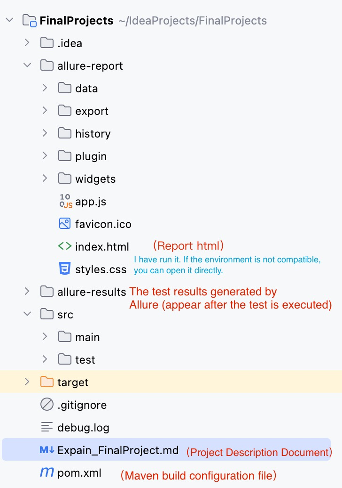
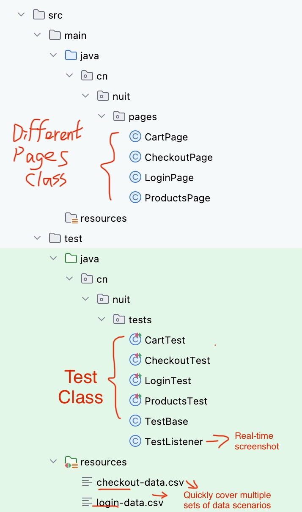
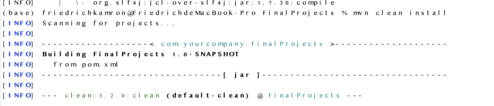
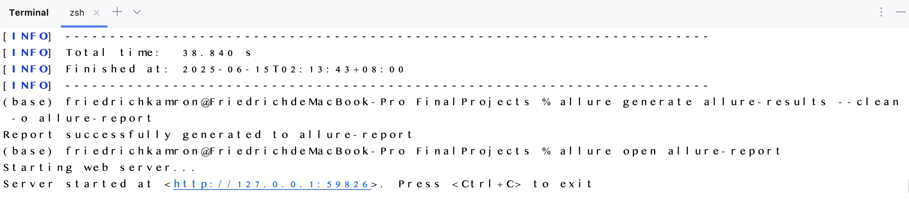

## 1. 📁 Project Structure


## 2. How to set up and run the tests.

```
# Build the test
mvn clean test

# Generate an Allure report (Allure must be installed locally)
allure serve allure-results
```
For mac:



## 3.  POM
When the page structure changes, only need to modify the page class instead of all test cases. The page method can be used across multiple tests. In addition, all key operation methods use Allure's @Step annotation. With the Allure report tool, each step of the test operation can be displayed in the report, which is convenient to trace back the failure step.

### Configuration design instructions of  pom.xml:
"Junit-jupiter" JUnit 5 core dependency. "Selenium-java "provides browser functions."Opencsv" parse CSV file. "Allure-junit5, allure-java-commons" collection Allure report generation and step tracking function. "Logback-classic" can provide log support during testing, which is convenient for debugging and reporting. Allure-maven" is used to generate HTML format reports.

## 4. DDT
@ParameterizedTest combined with @CsvFileSource to read the CSV file in the src/test/resources directory. The test logic is completely separated from the data, which improves the scalability of use cases. The new test data only needs to modify the CSV file, no need to modify the code.

